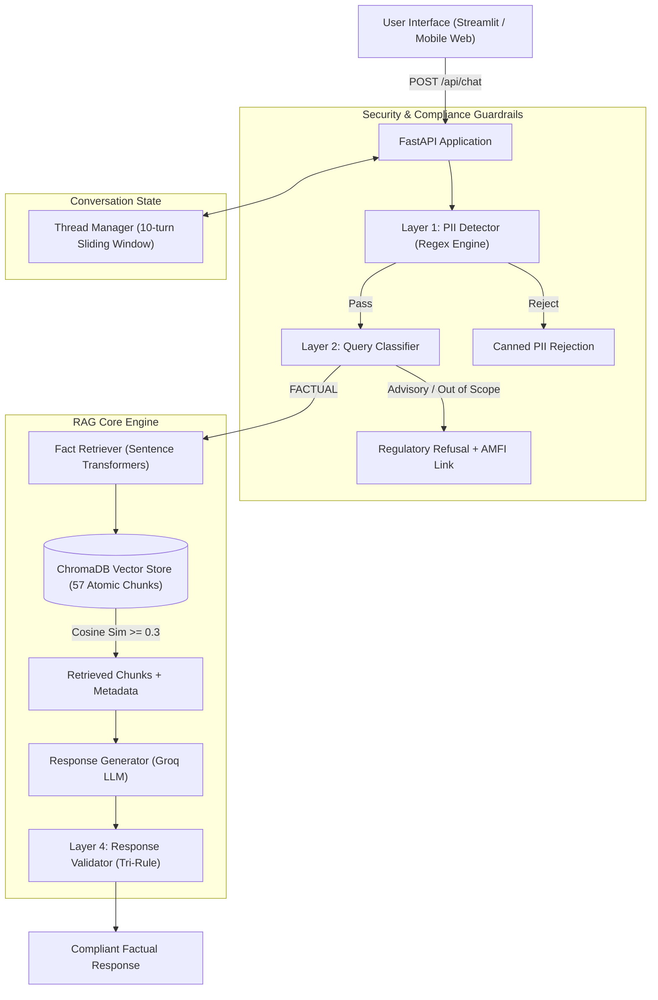

# Mutual Fund & Stock FAQ Assistant (Groww Facts Q&A)

[](https://www.python.org/downloads/)
[](https://fastapi.tiangolo.com)
[](https://streamlit.io)
[](https://www.trychroma.com)
[](https://groq.com)
[](https://www.sebi.gov.in)

A production-grade, compliance-first Retrieval-Augmented Generation (RAG) assistant designed for mutual fund investors and equity researchers. Built on **Groq LLM (`openai/gpt-oss-120b`)**, **ChromaDB**, **FastAPI**, and a **Stitch-designed Streamlit interface**, the system provides instant, factual answers grounded in official filings while strictly rejecting speculative advice and protecting personal identifiable information (PII).

> **Regulatory Compliance Guarantee:** Strictly facts-only. No investment advice, opinions, or return forecasts. Every response adheres to the Tri-Rule constraint: $\le 3$ sentences, exactly 1 official source citation link, and a statutory `"Last updated from sources: <date>"` footer.

---

## 📌 Features

- **Facts-Only Grounded Q&A**: Answers objective queries regarding expense ratios, exit loads, minimum SIPs, benchmarks, riskometer classifications, ELSS lock-in, and scheme fund managers.
- **5 Verified Data Sources**:
  - HDFC Mid Cap Fund – Direct Growth
  - HDFC Small Cap Fund – Direct Growth
  - HDFC Large Cap Fund – Direct Growth
  - HDFC Silver ETF FoF – Direct Growth
  - HDFC Multi Cap Fund – Direct Growth
- **Multi-Thread Chat Session Management**: UUID-based concurrent conversation sessions with 10-turn sliding window memory, thread isolation, and automatic 30-minute inactivity pruning.
- **Multi-Layer Guardrails**:
  - **Layer 1 (Zero-PII)**: Deterministic regex detector rejecting PAN, Aadhaar, phone numbers, emails, and OTPs before LLM execution.
  - **Layer 2 (Query Classifier)**: Routes queries into `FACTUAL`, `ADVISORY`, `OUT_OF_SCOPE`, or `PII_DETECTED`. Automatically refuses advisory and comparison questions with AMFI investor education links.
  - **Layer 3 (Prompt Grounding)**: Zero-temperature system prompt enforcing strict factual adherence.
  - **Layer 4 (Response Validator)**: Deterministically validates output length ($\le 3$ sentences), ensures citation URL presence, appends last-updated timestamp footer, and performs secondary PII suppression.
- **Stitch FinTech UI**: High-conviction UI designed with the *Facts-First Financial Intelligence* design system, featuring SEBI compliance notice, quick-action prompt chips, verified source badges, proof IDs, and real-time vector store indicators.
- **Automated Daily Ingestion Scheduler (GitHub Actions)**: Daily cron workflow executing at 10:00 AM IST (`30 4 * * *`) that automatically scrapes the 5 Groww sources, normalizes data, chunks facts, computes MiniLM-L6-v2 embeddings, and updates ChromaDB.

---

## 🏗️ Architecture



For complete architectural specifications, see [docs/architecture.md](file:///d:/Dipti/NextLeap_RAG_Project_Assignment2/docs/architecture.md).

---

## 🛠️ Tech Stack

| Layer | Component | Description |
|---|---|---|
| **Runtime** | Python 3.12 | Modern asynchronous Python runtime |
| **LLM Provider** | Groq API (`openai/gpt-oss-120b`) | Ultra-fast inference (< 500ms RTT) |
| **Embedding Model** | `sentence-transformers/all-MiniLM-L6-v2` | 384-dimensional dense semantic vectors |
| **Vector Database** | ChromaDB | Local persistent vector storage (57 indexed chunks) |
| **Backend REST API** | FastAPI + Uvicorn | Asynchronous REST API with CORS and OpenAPI docs |
| **Frontend UI** | Streamlit + Custom Stitch CSS | Modern emerald FinTech dashboard |
| **Testing Suite** | Pytest | Unit, integration, and end-to-end test cases |

---

## 📂 Curated Data Sources

| Scheme / Security | Category | Verified Groww URL |
|---|---|---|
| **HDFC Mid Cap Fund** | Equity - Mid Cap | `https://groww.in/mutual-funds/hdfc-mid-cap-fund-direct-growth` |
| **HDFC Small Cap Fund** | Equity - Small Cap | `https://groww.in/mutual-funds/hdfc-small-cap-fund-direct-growth` |
| **HDFC Large Cap Fund** | Equity - Large Cap | `https://groww.in/mutual-funds/hdfc-large-cap-fund-direct-growth` |
| **HDFC Silver ETF FoF** | Commodities - Silver | `https://groww.in/mutual-funds/hdfc-silver-etf-fof-direct-growth` |
| **HDFC Multi Cap Fund** | Equity - Multi Cap | `https://groww.in/mutual-funds/hdfc-multi-cap-fund-direct-growth` |

---

## 🚀 Setup & Installation

### 1. Prerequisites
- Python 3.10 or higher
- A Groq Cloud API Key ([console.groq.com](https://console.groq.com))

### 2. Clone and Setup Environment
```bash
git clone <repository_url>
cd NextLeap_RAG_Project_Assignment2

# Activate virtual environment (Windows)
venv\Scripts\activate

# Or on macOS/Linux
source venv/bin/activate

# Install required dependencies
pip install -r requirements.txt
```

### 3. Configure Environment Variables
Create a `.env` file in the project root directory:
```env
# Groq LLM Configuration
GROQ_API_KEY=gsk_your_groq_api_key_here
LLM_MODEL=openai/gpt-oss-120b
LLM_TEMPERATURE=0.0
LLM_MAX_TOKENS=200

# Embedding & ChromaDB
EMBEDDING_MODEL=sentence-transformers/all-MiniLM-L6-v2
CHROMA_PERSIST_DIR=./vectorstore/chroma_db
CHROMA_COLLECTION_NAME=mutual_fund_facts

# Retrieval Configuration
RETRIEVER_TOP_K=5
RELEVANCE_THRESHOLD=0.3

# Server Settings
API_HOST=0.0.0.0
API_PORT=8000
STREAMLIT_PORT=8501
THREAD_EXPIRY_MINUTES=30
MAX_HISTORY_TURNS=10
```

### 4. Ingest Data into ChromaDB (One-Time)
Run the ingestion script to parse raw data, generate field-aware atomic chunks, and index embeddings:
```bash
python scripts/ingest.py
```
*(The workspace already includes pre-indexed 57 chunks in `./vectorstore/chroma_db`)*.

---

## 💻 Running the Application

### Option 1: Native Stitch Web Interface (FastAPI Web Dashboard)
The assistant includes a full standalone production web dashboard created with Google Stitch (`stitch_fintech_faq_assistant`), served directly by the FastAPI backend at root:
```bash
uvicorn src.api.main:app --host 0.0.0.0 --port 8000
```
- **Stitch Web Interface:** `http://localhost:8000/`
- **Interactive OpenAPI / Swagger Docs:** `http://localhost:8000/docs`
- **Health check endpoint:** `http://localhost:8000/api/health`

### Option 2: Streamlit Frontend
Alternatively, launch the Streamlit frontend styled with the same *Facts-First Financial Intelligence* design system:
```bash
streamlit run ui/app.py --server.port 8501
```
Open your browser at `http://localhost:8501`.

---

## 🧪 Test Suite & Verification

Run all automated unit and integration tests:
```bash
python -m pytest tests/ -v
```

### Sample Verification Matrix:
| Query | Expected Type | Response Behavior |
|---|---|---|
| *"What is the expense ratio of HDFC Small Cap Fund?"* | `FACTUAL` | Returns `0.68%` + Groww citation link + date footer |
| *"Should I invest in HDFC Large Cap Fund?"* | `ADVISORY` | Polite refusal + SEBI/AMFI advisor link |
| *"My PAN is ABCDE1234F, check my balance"* | `PII_DETECTED` | Strict refusal alerting sensitive PII |
| *"What is the weather today in Mumbai?"* | `OUT_OF_SCOPE` | Polite domain scope limitation |
| *"What is the benchmark index of HDFC Silver ETF FoF?"* | `FACTUAL` | Returns `Domestic Price of Physical Silver` with official URL |

To run the live batch query benchmark:
```bash
python scripts/test_queries.py
```

---

## 📚 Project Documentation Index

All detailed project documents reside in the [`docs/`](file:///d:/Dipti/NextLeap_RAG_Project_Assignment2/docs) directory:

| Document | Purpose |
|---|---|
| [docs/problemStatement.md](file:///d:/Dipti/NextLeap_RAG_Project_Assignment2/docs/problemStatement.md) | Business context, 5 sources, product requirements, and compliance rules |
| [docs/architecture.md](file:///d:/Dipti/NextLeap_RAG_Project_Assignment2/docs/architecture.md) | Full architectural blueprint, data flow diagrams, and schema models |
| [docs/implementation-plan.md](file:///d:/Dipti/NextLeap_RAG_Project_Assignment2/docs/implementation-plan.md) | 6-phase engineering roadmap with detailed acceptance criteria |
| [docs/data_research.md](file:///d:/Dipti/NextLeap_RAG_Project_Assignment2/docs/data_research.md) | Empirical data research, chunking analysis, and embedding benchmarks |
| [docs/edge-case.md](file:///d:/Dipti/NextLeap_RAG_Project_Assignment2/docs/edge-case.md) | 8 categories of edge cases and verification test matrix |
| [docs/eval.md](file:///d:/Dipti/NextLeap_RAG_Project_Assignment2/docs/eval.md) | Quantitative evaluation metrics (Retrieval Recall, Faithfulness, Latency) |
| [docs/issues.md](file:///d:/Dipti/NextLeap_RAG_Project_Assignment2/docs/issues.md) | Manual verification log, bug fixes, edge cases, and root cause analyses |
| [docs/deployment-plan.md](file:///d:/Dipti/NextLeap_RAG_Project_Assignment2/docs/deployment-plan.md) | Comprehensive Railway cloud deployment blueprint, Docker setup, and CI/CD sync |
| [docs/vercel-deployment.md](file:///d:/Dipti/NextLeap_RAG_Project_Assignment2/docs/vercel-deployment.md) | Vercel Serverless Function configuration, ephemeral `/tmp` adaptation, and deployment guide |
| [docs/stitch_ui_prompt.md](file:///d:/Dipti/NextLeap_RAG_Project_Assignment2/docs/stitch_ui_prompt.md) | Design specifications and prompt used for the Stitch UI generation |

---

## ⚖️ Regulatory Disclaimer

This application is strictly an informational search assistant powered by publicly available statutory filings and fund factsheets. **It does not provide investment advice, financial planning, buy/sell recommendations, or performance forecasts.** Mutual fund investments are subject to market risks; read all scheme-related documents carefully before investing.

---

## 📄 License

MIT License. Designed for the NextLeap AI/ML Product Engineering Assignment.


