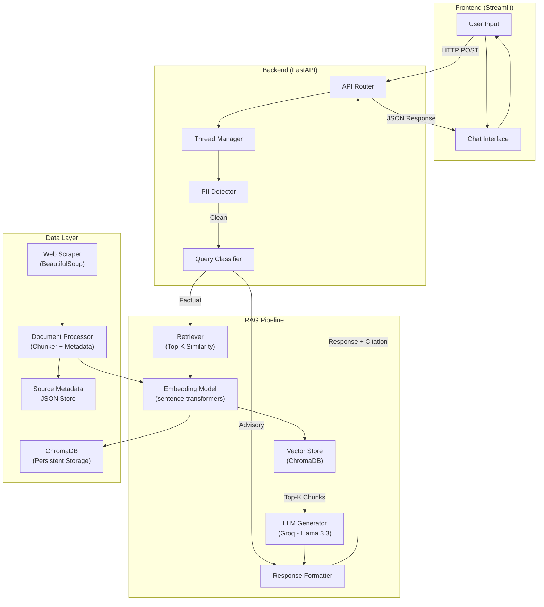
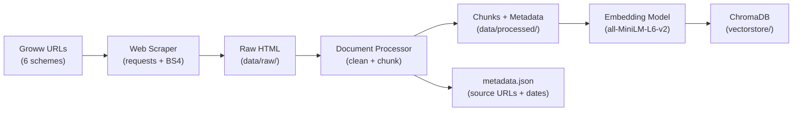
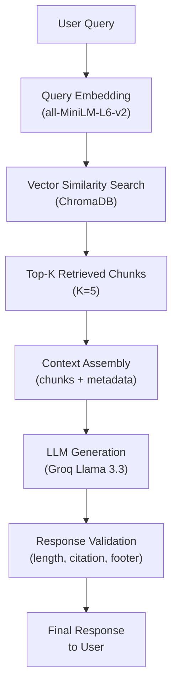
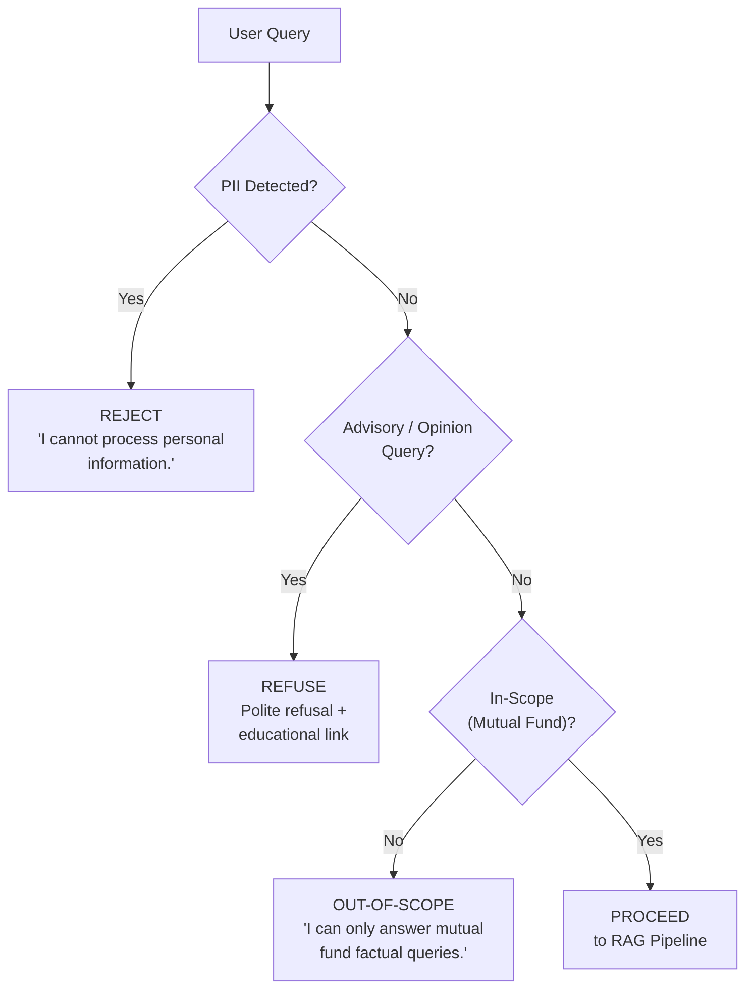
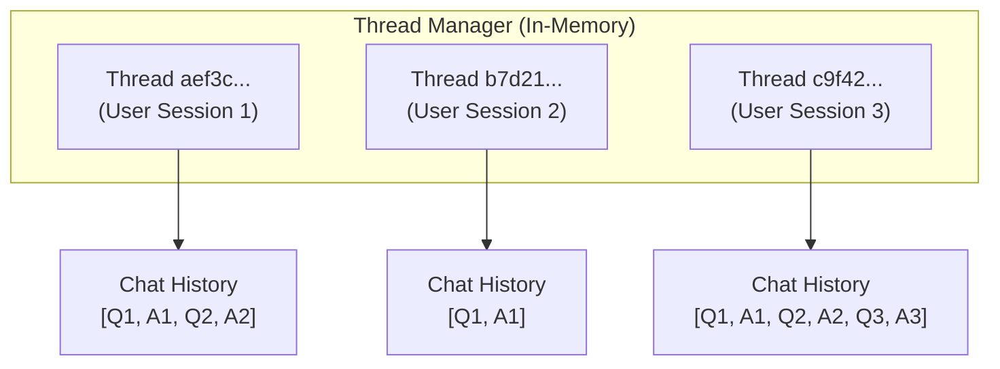
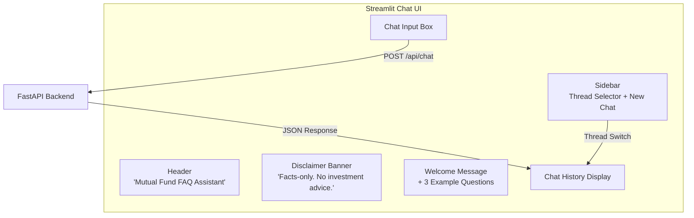
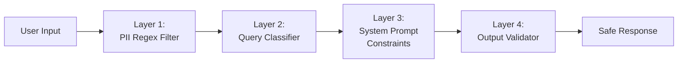
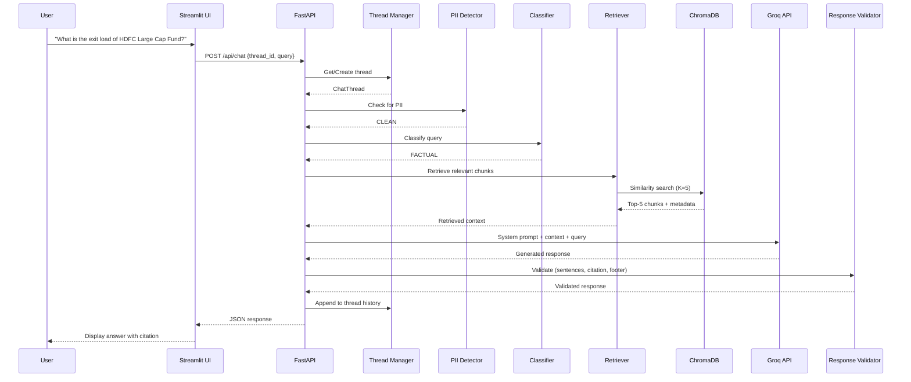
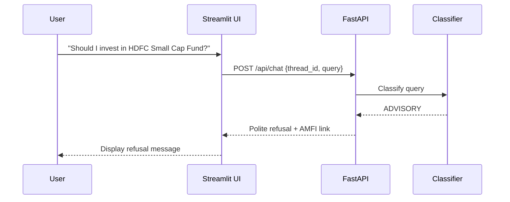

# Architecture Document — Mutual Fund FAQ Assistant

> **Project:** Mutual Fund FAQ Assistant (Facts-Only Q&A)
> **Version:** 1.0
> **Date:** 2026-11-07
> **Reference:** [problemStatement.md](file:///d:/Dipti/NextLeap_RAG_Project_Assignment2/problemStatement.md)

---

## Table of Contents

1. [System Overview](#1-system-overview)
2. [High-Level Architecture](#2-high-level-architecture)
3. [Tech Stack](#3-tech-stack)
4. [Project Structure](#4-project-structure)
5. [Data Ingestion Pipeline](#5-data-ingestion-pipeline)
6. [RAG Pipeline](#6-rag-pipeline)
7. [Query Classification & Refusal Logic](#7-query-classification--refusal-logic)
8. [Prompt Engineering](#8-prompt-engineering)
9. [Multi-Thread Chat Management](#9-multi-thread-chat-management)
10. [API Design](#10-api-design)
11. [Frontend / UI Architecture](#11-frontend--ui-architecture)
12. [Security & Privacy Guardrails](#12-security--privacy-guardrails)
13. [Data Flow — End-to-End](#13-data-flow--end-to-end)
14. [Deployment Architecture](#14-deployment-architecture)
15. [Testing Strategy](#15-testing-strategy)
16. [Known Limitations & Future Scope](#16-known-limitations--future-scope)

---

## 1. System Overview

The Mutual Fund & Stock FAQ Assistant is a **Retrieval-Augmented Generation (RAG)** application that answers factual questions about mutual fund schemes and listed stocks. It ingests data from 9 Groww URLs (6 mutual funds/ETFs + 3 stocks), stores it in a vector database, retrieves relevant context at query time, and generates concise, source-cited answers using an LLM.

### Design Principles

| Principle | Implementation |
|-----------|---------------|
| **Accuracy over intelligence** | RAG retrieval ensures answers are grounded in source documents, not hallucinated |
| **Facts-only** | Query classifier + system prompt prevent advisory/opinion responses |
| **Transparency** | Every response includes exactly one citation link + last-updated date |
| **Privacy-first** | No PII collection; input sanitization rejects sensitive data |
| **Simplicity** | Minimal UI, lightweight stack, easy local setup |

---

## 2. High-Level Architecture



---

## 3. Tech Stack

### Core Stack

| Layer | Technology | Justification |
|-------|-----------|---------------|
| **Language** | Python 3.10+ | Ecosystem maturity for ML/NLP |
| **Backend API** | FastAPI | Async support, auto-docs, lightweight |
| **Frontend** | Streamlit | Rapid prototyping, built-in chat UI components |
| **Vector Database** | ChromaDB | Embedded, no external infra, persistent storage |
| **Embedding Model** | `sentence-transformers/all-MiniLM-L6-v2` | Fast, 384-dim, good semantic quality for FAQ-style retrieval |
| **LLM** | Groq API (`llama-3.3-70b-versatile`) | Free tier available, ultra-fast inference, strong instruction-following, good for constrained generation |
| **Web Scraping** | BeautifulSoup4 + Requests | Lightweight HTML parsing for Groww pages |

### Supporting Libraries

| Library | Purpose |
|---------|---------|
| `langchain` | Orchestration — document loaders, text splitters, chain composition |
| `langchain-groq` | Groq LLM integration via LangChain |
| `chromadb` | Vector store client |
| `sentence-transformers` | Local embedding generation |
| `uvicorn` | ASGI server for FastAPI |
| `python-dotenv` | Environment variable management |
| `uuid` | Thread ID generation |
| `pydantic` | Request/response validation |

### Dependency File

```
# requirements.txt
fastapi>=0.104.0
uvicorn>=0.24.0
streamlit>=1.28.0
langchain>=0.1.0
langchain-groq>=0.1.0
langchain-community>=0.0.10
chromadb>=0.4.0
sentence-transformers>=2.2.0
beautifulsoup4>=4.12.0
requests>=2.31.0
python-dotenv>=1.0.0
pydantic>=2.0.0
```

---

## 4. Project Structure

```
NextLeap_RAG_Project_Assignment2/
│
├── README.md                        # Setup, architecture overview, limitations
├── problemStatement.md              # Problem statement document
├── architecture.md                  # This file
├── requirements.txt                 # Python dependencies
├── .env.example                     # Template for environment variables
├── .gitignore
│
├── docs/
│   └── problemstatement.txt.txt     # Original problem statement
│
├── data/
│   ├── raw/                         # Raw scraped HTML/text
│   ├── processed/                   # Cleaned, chunked documents (JSON)
│   └── metadata.json                # Source URLs, scrape dates, scheme info
│
├── vectorstore/
│   └── chroma_db/                   # Persistent ChromaDB storage
│
├── src/
│   ├── __init__.py
│   │
│   ├── config.py                    # App configuration & constants
│   │
│   ├── ingestion/
│   │   ├── __init__.py
│   │   ├── scraper.py               # Web scraper for Groww URLs
│   │   ├── processor.py             # Document cleaning & chunking
│   │   └── embedder.py              # Embedding generation & ChromaDB upsert
│   │
│   ├── rag/
│   │   ├── __init__.py
│   │   ├── retriever.py             # Vector similarity search
│   │   ├── generator.py             # LLM prompt + response generation
│   │   ├── chain.py                 # End-to-end RAG chain orchestration
│   │   └── prompts.py               # System & user prompt templates
│   │
│   ├── guardrails/
│   │   ├── __init__.py
│   │   ├── classifier.py            # Query type classification (factual vs advisory)
│   │   ├── pii_detector.py          # PII detection & rejection
│   │   └── response_validator.py    # Output validation (length, citation, footer)
│   │
│   ├── chat/
│   │   ├── __init__.py
│   │   └── thread_manager.py        # Multi-thread session management
│   │
│   └── api/
│       ├── __init__.py
│       ├── main.py                  # FastAPI app entry point
│       ├── routes.py                # API route definitions
│       └── models.py                # Pydantic request/response schemas
│
├── ui/
│   └── app.py                       # Streamlit chat interface
│
├── scripts/
│   ├── ingest.py                    # One-shot ingestion script
│   └── test_queries.py              # Manual query testing script
│
└── tests/
    ├── test_scraper.py
    ├── test_classifier.py
    ├── test_retriever.py
    ├── test_generator.py
    ├── test_pii_detector.py
    └── test_e2e.py
```

---

## 5. Data Ingestion Pipeline

### 5.1 Pipeline Flow



### 5.2 Scraper (`src/ingestion/scraper.py`)

| Aspect | Detail |
|--------|--------|
| **Target URLs** | 5 Groww pages (5 curated HDFC mutual funds/ETFs) |
| **Extraction targets** | **Mutual Funds:** Scheme name, category, expense ratio, exit load, min SIP, min lump sum, benchmark index, riskometer, fund manager, lock-in period, statement download process. |
| **Method** | HTTP GET → parse HTML with BeautifulSoup → extract structured fields from known CSS selectors / page structure |
| **Output** | One JSON file per scheme in `data/raw/` |
| **Error handling** | Retry with exponential backoff (max 3 retries); log failures |

### 5.3 Document Processor (`src/ingestion/processor.py`)

| Step | Detail |
|------|--------|
| **Cleaning** | Strip HTML tags, normalize whitespace, remove ads/navigation boilerplate |
| **Structuring** | Convert each scheme into a structured document with clearly labeled fields |
| **Chunking strategy** | **Field-aware chunking** — each scheme fact (expense ratio, exit load, etc.) becomes its own chunk with metadata |
| **Chunk size** | 200–500 characters per chunk (small, focused chunks for precise retrieval) |
| **Metadata per chunk** | `scheme_name`, `field_name`, `source_url`, `scrape_date`, `chunk_id` |

### 5.4 Embedder (`src/ingestion/embedder.py`)

| Aspect | Detail |
|--------|--------|
| **Model** | `sentence-transformers/all-MiniLM-L6-v2` (384 dimensions) |
| **Embedding target** | Chunk text concatenated with scheme name for better disambiguation |
| **Storage** | ChromaDB persistent collection named `mutual_fund_facts` |
| **Metadata stored** | All chunk metadata (scheme, field, URL, date) stored alongside vectors |
| **Deduplication** | Chunks are upserted by `chunk_id` to avoid duplicates on re-ingestion |

### 5.5 Metadata Store (`data/metadata.json`)

```json
{
  "sources": [
    {
      "scheme_name": "HDFC Small Cap Fund - Direct Growth",
      "source_url": "https://groww.in/mutual-funds/hdfc-small-cap-fund-direct-growth",
      "scrape_date": "2026-11-07",
      "category": "Small Cap",
      "amc": "HDFC AMC"
    }
  ],
  "last_full_ingestion": "2026-11-07T17:00:00+05:30",
  "total_chunks": 120,
  "embedding_model": "all-MiniLM-L6-v2"
}
```

---

## 6. RAG Pipeline

### 6.1 Pipeline Stages



### 6.2 Retriever (`src/rag/retriever.py`)

| Parameter | Value | Rationale |
|-----------|-------|-----------|
| **Search type** | Cosine similarity | Standard for sentence-transformer embeddings |
| **Top-K** | 5 | Enough context for factual answers; small enough to stay within prompt limits |
| **Metadata filter** | Optional scheme-name filter when query mentions a specific fund | Improves precision |
| **Relevance threshold** | Score ≥ 0.3 | Discard low-relevance results to reduce noise |
| **Re-ranking** | None (V1) | Future enhancement — add cross-encoder re-ranker |

### 6.3 Generator (`src/rag/generator.py`)

| Parameter | Value |
|-----------|-------|
| **Model** | `llama-3.3-70b-versatile` |
| **Temperature** | 0.1 (low — factual, deterministic) |
| **Max output tokens** | 200 |
| **System prompt** | See [Section 8 — Prompt Engineering](#8-prompt-engineering) |
| **Input format** | System prompt + retrieved context chunks + user query |
| **Fallback** | If no relevant chunks found, respond: *"I don't have information about that. Please check the official AMC website."* |

### 6.4 Response Formatter (`src/guardrails/response_validator.py`)

Every generated response is post-processed to ensure compliance:

| Check | Rule | Action on Failure |
|-------|------|-------------------|
| **Sentence count** | ≤ 3 sentences | Truncate to first 3 sentences |
| **Citation** | Exactly 1 source URL present | Inject source URL from chunk metadata |
| **Footer** | `"Last updated from sources: <date>"` present | Append footer with `scrape_date` |
| **PII in output** | No PII patterns in response | Strip any accidental PII leakage |

---

## 7. Query Classification & Refusal Logic

### 7.1 Classification Flow



### 7.2 Query Classifier (`src/guardrails/classifier.py`)

The classifier uses a **keyword + LLM hybrid approach**:

**Layer 1 — Rule-Based (Fast Path):**

| Category | Pattern Examples | Action |
|----------|-----------------|--------|
| **Advisory** | "should I", "recommend", "better fund", "good investment", "which is best", "will it grow" | Refuse |
| **Comparison** | "compare", "vs", "better than", "which one" | Refuse |
| **Performance prediction** | "will returns", "future", "predict", "guaranteed" | Refuse |
| **PII** | Regex for PAN (`[A-Z]{5}[0-9]{4}[A-Z]`), Aadhaar (`\d{4}\s?\d{4}\s?\d{4}`), phone, email | Reject |

**Layer 2 — LLM Classification (Fallback):**

For ambiguous queries that pass Layer 1, send to LLM with a classification prompt:

```
Classify this query as one of: FACTUAL, ADVISORY, OUT_OF_SCOPE
Query: "{user_query}"
Respond with only the classification label.
```

### 7.3 Refusal Response Templates

**Advisory refusal:**
> *"I'm designed to provide facts only and cannot offer investment advice or recommendations. For investment guidance, please consult a SEBI-registered advisor. You can learn more at https://www.amfiindia.com/investor-corner/knowledge-center.html"*
> *Last updated from sources: 2026-11-07*

**PII rejection:**
> *"I cannot process personal or sensitive information such as PAN, Aadhaar, or account numbers. Please do not share personal data. For account-related queries, visit your AMC's official portal directly."*

**Out-of-scope:**
> *"I can only answer factual questions about mutual fund schemes listed in my knowledge base. Please rephrase your question about a specific scheme's details."*

---

## 8. Prompt Engineering

### 8.1 System Prompt (`src/rag/prompts.py`)

```python
SYSTEM_PROMPT = """You are a facts-only mutual fund FAQ assistant. You answer objective, 
verifiable questions about mutual fund schemes using ONLY the provided context.

STRICT RULES:
1. Answer in a MAXIMUM of 3 sentences.
2. Include EXACTLY ONE source citation URL from the context metadata.
3. End every response with: "Last updated from sources: {scrape_date}"
4. Use ONLY information present in the provided context. Do NOT hallucinate.
5. If the context does not contain the answer, say: "I don't have this information 
   in my current data. Please check the official AMC website."

YOU MUST NEVER:
- Give investment advice, opinions, or recommendations
- Compare funds or predict performance
- Suggest whether to buy, sell, or hold any fund
- Process or acknowledge any personal information (PAN, Aadhaar, phone, email)
- Make up information not present in the context

YOU ARE NOT a financial advisor. You are a factual information retrieval system."""
```

### 8.2 User Prompt Template

```python
USER_PROMPT_TEMPLATE = """Context from knowledge base:
---
{retrieved_context}
---
Source URL: {source_url}
Data last scraped: {scrape_date}

User question: {user_query}

Provide a factual answer following all system rules."""
```

---

## 9. Multi-Thread Chat Management

### 9.1 Thread Architecture



### 9.2 Thread Manager (`src/chat/thread_manager.py`)

| Feature | Implementation |
|---------|---------------|
| **Thread creation** | Generate UUID on first message; return to client |
| **Thread storage** | In-memory `dict[str, ChatThread]` (V1); Redis for production |
| **Chat history** | Store last **10 turns** (Q+A pairs) per thread for context continuity |
| **Thread isolation** | Each thread has independent history; no cross-thread leakage |
| **Thread expiry** | Auto-expire threads after **30 minutes** of inactivity |
| **Concurrency** | Thread-safe via `asyncio.Lock` per thread |

### 9.3 ChatThread Data Model

```python
@dataclass
class ChatThread:
    thread_id: str                          # UUID
    created_at: datetime
    last_active: datetime
    history: list[dict[str, str]]           # [{"role": "user", "content": "..."}, ...]
    max_history: int = 20                   # 10 turns × 2 messages
```

---

## 10. API Design

### 10.1 Endpoints

| Method | Endpoint | Description | Auth |
|--------|----------|-------------|------|
| `POST` | `/api/chat` | Send a message and get a response | None (V1) |
| `POST` | `/api/thread/new` | Create a new chat thread | None |
| `GET` | `/api/thread/{thread_id}/history` | Get chat history for a thread | None |
| `DELETE` | `/api/thread/{thread_id}` | Delete a chat thread | None |
| `GET` | `/api/health` | Health check | None |

### 10.2 Request/Response Schemas (`src/api/models.py`)

**Chat Request:**
```json
{
  "thread_id": "aef3c1a2-...",       // Optional; auto-creates if omitted
  "query": "What is the expense ratio of HDFC Small Cap Fund?"
}
```

**Chat Response:**
```json
{
  "thread_id": "aef3c1a2-...",
  "query": "What is the expense ratio of HDFC Small Cap Fund?",
  "response": "The expense ratio of HDFC Small Cap Fund - Direct Growth is 0.65%. Source: https://groww.in/mutual-funds/hdfc-small-cap-fund-direct-growth\nLast updated from sources: 2026-11-07",
  "source_url": "https://groww.in/mutual-funds/hdfc-small-cap-fund-direct-growth",
  "query_type": "FACTUAL",
  "timestamp": "2026-11-07T17:30:00+05:30"
}
```

**Refusal Response:**
```json
{
  "thread_id": "aef3c1a2-...",
  "query": "Should I invest in HDFC Small Cap Fund?",
  "response": "I'm designed to provide facts only and cannot offer investment advice...",
  "source_url": null,
  "query_type": "ADVISORY",
  "timestamp": "2026-11-07T17:30:00+05:30"
}
```

---

## 11. Frontend / UI Architecture

### 11.1 Streamlit App (`ui/app.py`)



### 11.2 UI Components

| Component | Details |
|-----------|---------|
| **Header** | App title + Groww-styled branding |
| **Disclaimer** | Persistent banner: `"⚠️ Facts-only. No investment advice."` |
| **Welcome message** | Shown on new thread; introduces the assistant |
| **Example questions** | 3 clickable example queries (see below) |
| **Chat input** | `st.chat_input()` for user messages |
| **Chat history** | `st.chat_message()` for threaded conversation display |
| **Sidebar** | Thread list, "New Chat" button, thread management |

### 11.3 Example Questions

1. *"What is the expense ratio of HDFC Small Cap Fund?"*
2. *"What is the exit load for HDFC Large Cap Fund?"*
3. *"What is the minimum SIP amount for HDFC Multi Cap Fund?"*

---

## 12. Security & Privacy Guardrails

### 12.1 Defense Layers



### 12.2 PII Detection (`src/guardrails/pii_detector.py`)

| PII Type | Regex Pattern | Action |
|----------|---------------|--------|
| **PAN** | `[A-Z]{5}[0-9]{4}[A-Z]{1}` | Reject input |
| **Aadhaar** | `\b\d{4}[\s-]?\d{4}[\s-]?\d{4}\b` | Reject input |
| **Phone** | `\b[6-9]\d{9}\b` | Reject input |
| **Email** | `[\w.-]+@[\w.-]+\.\w+` | Reject input |
| **Account no.** | `\b\d{9,18}\b` (in context of "account") | Reject input |
| **OTP** | `\b\d{4,6}\b` (in context of "otp"/"verify") | Reject input |

### 12.3 Security Measures

| Measure | Implementation |
|---------|---------------|
| **Input sanitization** | Strip HTML, limit query to 500 characters |
| **No data persistence of user queries** | Chat history stored in-memory only; lost on restart |
| **API rate limiting** | 30 requests/minute per IP (via `slowapi`) |
| **No authentication data** | No login, no user accounts, no cookies with PII |
| **Prompt injection defense** | System prompt positioned as immutable; user input clearly delimited |
| **CORS** | Restricted to frontend origin only |

---

## 13. Data Flow — End-to-End

### 13.1 Happy Path (Factual Query)



### 13.2 Refusal Path (Advisory Query)



---

## 14. Deployment Architecture

### 14.1 Local Development (V1 — Target)

```
┌─────────────────────────────────────────────┐
│              Local Machine                   │
│                                              │
│  ┌──────────────┐     ┌──────────────────┐  │
│  │  Streamlit    │────▶│  FastAPI          │  │
│  │  (port 8501)  │◀────│  (port 8000)     │  │
│  └──────────────┘     └────────┬─────────┘  │
│                                │              │
│                     ┌──────────▼─────────┐   │
│                     │  ChromaDB           │   │
│                     │  (embedded, disk)   │   │
│                     └────────────────────┘   │
│                                              │
│            ┌──────────────────┐              │
│            │ Groq API (ext)   │              │
│            └──────────────────┘              │
└─────────────────────────────────────────────┘
```

### 14.2 Environment Variables (`.env`)

```env
# LLM
GROQ_API_KEY=your_groq_api_key_here

# Embedding
EMBEDDING_MODEL=sentence-transformers/all-MiniLM-L6-v2

# ChromaDB
CHROMA_PERSIST_DIR=./vectorstore/chroma_db
CHROMA_COLLECTION_NAME=mutual_fund_facts

# RAG
RETRIEVER_TOP_K=5
RELEVANCE_THRESHOLD=0.3
LLM_TEMPERATURE=0.1
LLM_MAX_TOKENS=200

# Server
API_HOST=0.0.0.0
API_PORT=8000
STREAMLIT_PORT=8501

# Thread
THREAD_EXPIRY_MINUTES=30
MAX_HISTORY_TURNS=10
```

### 14.3 Startup Commands

```bash
# Step 1: Install dependencies
pip install -r requirements.txt

# Step 2: Run data ingestion (one-time)
python scripts/ingest.py

# Step 3: Start the API server
uvicorn src.api.main:app --host 0.0.0.0 --port 8000

# Step 4: Start the UI (separate terminal)
streamlit run ui/app.py --server.port 8501
```

---

## 15. Testing Strategy

### 15.1 Test Matrix

| Test Type | Scope | Tool | Location |
|-----------|-------|------|----------|
| **Unit tests** | Scraper, classifier, PII detector, response validator | `pytest` | `tests/` |
| **Integration tests** | RAG chain end-to-end (retriever → generator → validator) | `pytest` | `tests/test_e2e.py` |
| **Factual accuracy** | Verify correct facts retrieved for sample queries | Manual + script | `scripts/test_queries.py` |
| **Refusal accuracy** | Verify advisory queries are properly refused | `pytest` | `tests/test_classifier.py` |
| **PII detection** | Verify all PII patterns are caught | `pytest` | `tests/test_pii_detector.py` |

### 15.2 Sample Test Cases

| # | Query | Expected Type | Expected Behavior |
|---|-------|---------------|-------------------|
| 1 | "What is the expense ratio of HDFC Small Cap Fund?" | FACTUAL | Returns expense ratio + citation |
| 2 | "Should I invest in HDFC Large Cap Fund?" | ADVISORY | Polite refusal + AMFI link |
| 3 | "My PAN is ABCDE1234F, check my investment" | PII_DETECTED | PII rejection message |
| 4 | "What is the weather today?" | OUT_OF_SCOPE | Scope limitation message |
| 5 | "Exit load for HDFC Multi Cap Fund?" | FACTUAL | Returns exit load + citation |
| 6 | "Compare HDFC Small Cap vs Large Cap" | ADVISORY | Refusal (comparison) |
| 7 | "What is the benchmark index for HDFC Silver ETF FoF?" | FACTUAL | Returns benchmark + citation |

---

## 16. Known Limitations & Future Scope

### 16.1 V1 Limitations

| Limitation | Impact | Mitigation |
|------------|--------|------------|
| **Static data** | Scheme data may go stale | Manual re-ingestion; display `scrape_date` in footer |
| **Groww page structure changes** | Scraper may break if Groww redesigns pages | Modular scraper with configurable selectors |
| **In-memory thread store** | Chat history lost on server restart | Acceptable for V1; upgrade to Redis/SQLite for production |
| **No authentication** | Open access to the API | Acceptable for local/demo use |
| **6 schemes only** | Limited fund coverage | Expand corpus in future iterations |
| **English only** | No multilingual support | Future enhancement |
| **No re-ranker** | Retrieval precision may be suboptimal | Add cross-encoder re-ranker in V2 |

### 16.2 Future Enhancements (V2+)

| Enhancement | Priority | Effort |
|-------------|----------|--------|
| Scheduled auto-ingestion (daily/weekly) | High | Medium |
| Redis-backed thread persistence | High | Low |
| Cross-encoder re-ranker | Medium | Medium |
| Expand to 50+ schemes across multiple AMCs | Medium | Medium |
| Add factsheet PDF parsing (for performance queries) | Medium | High |
| User authentication & rate limiting per user | Low | Medium |
| Multilingual support (Hindi, regional) | Low | High |
| Containerized deployment (Docker) | Medium | Low |
| Monitoring & observability (logging, metrics) | Medium | Medium |

---

> **Document maintained by:** Project Team
> **Last updated:** 2026-11-07

