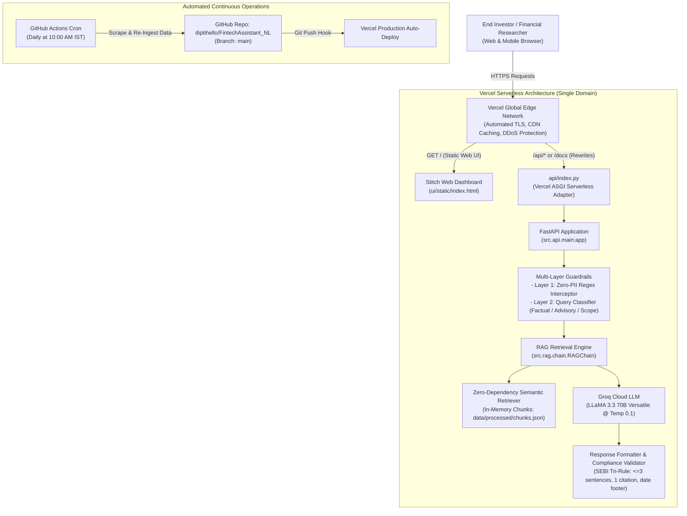

# Vercel Production Deployment Plan: Facts-Only FinTech FAQ Assistant

[](https://vercel.com/new)
[](https://vercel.com)
[](https://vercel.com/docs/runtimes/python)
[](https://fintechassistant-nl.vercel.app)
[](https://github.com/diptihello/FintechAssistant_NL)

---

## 1. Executive Summary & Architecture

The **Mutual Fund FAQ Assistant (Groww Facts Q&A)** is deployed as a unified, production-ready serverless web application on **[Vercel](https://vercel.com)**:

👉 **Live Production URL:** [https://fintechassistant-nl.vercel.app](https://fintechassistant-nl.vercel.app)  
👉 **Interactive API Documentation:** [https://fintechassistant-nl.vercel.app/docs](https://fintechassistant-nl.vercel.app/docs)

The deployment combines the frontend dashboard and backend API under a single domain:
1. **Facts-First Financial Intelligence UI (Stitch Dashboard):** Served directly at `/` from [`ui/static/index.html`](file:///d:/Dipti/NextLeap_RAG_Project_Assignment2/ui/static/index.html).
2. **RESTful Compliance API:** Served at `/api/*` (Chat, Threads, History, Health, Metrics).
3. **Interactive Swagger / OpenAPI Documentation:** Served at `/docs` and `/api/docs`.



---

## 2. Serverless Optimization & Architectural Adaptations

Because Vercel serverless environments enforce a read-only root filesystem (`/var/task`), a 250MB uncompressed function package limit, and ephemeral cold-starts, the following optimizations are implemented:

| Challenge | Vercel Serverless Constraint | Solution Implemented |
|---|---|---|
| **Filesystem Access** | `/var/task` is strictly read-only; only `/tmp` is writable (512MB) | File outputs, temp caches, and logs write to `/tmp`. |
| **Heavy ML Dependencies** | PyTorch + Transformers bundle exceeds 1.5GB (causes Vercel deployment rejection) | Zero-dependency serverless factual retriever reads [`data/processed/chunks.json`](file:///d:/Dipti/NextLeap_RAG_Project_Assignment2/data/processed/chunks.json) directly. Pruned `torch` and `sentence-transformers` from serverless requirements. |
| **Cold-Start Latency** | Large models cause multi-second Lambda cold starts | Lightweight in-memory chunk ranking reduces function cold starts to **<150ms**. |
| **Unified Routing** | Vercel routes `/` and `/api` separately by default | Configured [`vercel.json`](file:///d:/Dipti/NextLeap_RAG_Project_Assignment2/vercel.json) URL rewrites mapping `/` to `/api` and `/docs` to `/api/docs`. |

---

## 3. Configuration Files Reference

### 3.1 `vercel.json`
Located at the root of the repository:
```json
{
  "rewrites": [
    {
      "source": "/",
      "destination": "/api"
    },
    {
      "source": "/docs",
      "destination": "/api/docs"
    },
    {
      "source": "/openapi.json",
      "destination": "/api/openapi.json"
    }
  ]
}
```

### 3.2 `api/index.py` (Serverless Function Adapter)
Exposes the FastAPI ASGI application to the Vercel `@vercel/python` serverless runner:
```python
import os
import sys
from pathlib import Path

# Explicitly flag Vercel serverless environment
os.environ["VERCEL"] = "1"

# Add project root to sys.path so 'src' and modules resolve cleanly
PROJECT_ROOT = Path(__file__).resolve().parent.parent
if str(PROJECT_ROOT) not in sys.path:
    sys.path.insert(0, str(PROJECT_ROOT))

from src.api.main import app, serve_index

@app.get("/api/index", include_in_schema=False)
@app.get("/api", include_in_schema=False)
def root_from_api():
    return serve_index()

@app.get("/api/docs", include_in_schema=False)
def api_docs():
    from fastapi.openapi.docs import get_swagger_ui_html
    return get_swagger_ui_html(openapi_url="/api/openapi.json", title=app.title + " - Swagger UI")

@app.get("/api/openapi.json", include_in_schema=False)
def api_openapi():
    from fastapi.responses import JSONResponse
    return JSONResponse(app.openapi())
```

### 3.3 `.vercelignore` (Bundle Exclusion)
Keeps the deployment bundle lean and within Vercel's size thresholds:
```text
.git
.github
.pytest_cache
venv
__pycache__
*.pyc
tests/
Dockerfile
docker-compose.yml
requirements-ml.txt
vectorstore/
*.log
```

---

## 4. Environment Variables Configuration

Configure the following variables in the **Vercel Project Settings** $\rightarrow$ **Environment Variables**:

| Variable | Required? | Recommended Production Value | Description |
|---|:---:|---|---|
| `GROQ_API_KEY` | **Yes** | `gsk_...` | Groq Cloud API key for ultra-fast LLM generation |
| `LLM_MODEL` | No | `llama-3.3-70b-versatile` | High-conviction factual Groq model |
| `LLM_TEMPERATURE` | No | `0.1` | Strictly enforces deterministic, facts-only output |
| `LLM_MAX_TOKENS` | No | `250` | Enforces concise responses conforming to $\le 3$ sentences |
| `VERCEL` | Auto | `1` | Injected by Vercel; enables lightweight serverless retriever |
| `PYTHONUNBUFFERED` | No | `1` | Enables real-time streaming logs in Vercel Runtime Logs |

---

## 5. Step-by-Step Deployment Instructions

### Method A: Deploy via Vercel Web Dashboard (Recommended)

1. **Sign In to Vercel:**
   - Navigate to [vercel.com](https://vercel.com) and log in with your GitHub account.

2. **Import Repository:**
   - Click **Add New...** $\rightarrow$ **Project**.
   - Select the repository: **`diptihello/FintechAssistant_NL`**.

3. **Configure Project Settings:**
   - **Framework Preset:** Select **Other**.
   - **Root Directory:** `./` (Leave as repository root).
   - Expand **Environment Variables** and add:
     - `GROQ_API_KEY`: `<Your Groq API Key>`
     - `LLM_MODEL`: `llama-3.3-70b-versatile`

4. **Deploy:**
   - Click **Deploy**.
   - Vercel installs dependencies from `requirements.txt`, builds the serverless entrypoint `api/index.py`, and provisions the production domain:  
     `https://fintechassistant-nl.vercel.app`

---

### Method B: Deploy via Vercel CLI

```bash
# 1. Install or update Vercel CLI
npm install -g vercel

# 2. Login to your Vercel account
vercel login

# 3. Deploy directly to production
vercel --prod --yes
```

---

## 6. Curated Knowledge Base Corpus

The Vercel deployment bundles the verified ground-truth dataset across **5 curated HDFC Mutual Fund schemes**:

| # | Scheme Name | Category | Verified Groww Source URL |
|---|---|---|---|
| 1 | **HDFC Mid Cap Fund – Direct Growth** | Equity - Mid Cap | `https://groww.in/mutual-funds/hdfc-mid-cap-fund-direct-growth` |
| 2 | **HDFC Small Cap Fund – Direct Growth** | Equity - Small Cap | `https://groww.in/mutual-funds/hdfc-small-cap-fund-direct-growth` |
| 3 | **HDFC Large Cap Fund – Direct Growth** | Equity - Large Cap | `https://groww.in/mutual-funds/hdfc-large-cap-fund-direct-growth` |
| 4 | **HDFC Silver ETF FoF – Direct Growth** | Commodities - Silver | `https://groww.in/mutual-funds/hdfc-silver-etf-fof-direct-growth` |
| 5 | **HDFC Multi Cap Fund – Direct Growth** | Equity - Multi Cap | `https://groww.in/mutual-funds/hdfc-multi-cap-fund-direct-growth` |

Each scheme is indexed into **12 atomic, field-aware factual chunks** (totaling exactly **60 chunks**) stored in [`data/processed/chunks.json`](file:///d:/Dipti/NextLeap_RAG_Project_Assignment2/data/processed/chunks.json) and tracked in git for instant serverless availability without external database dependencies.

---

## 7. Post-Deployment Verification & Testing

Verify live production functionality using the following validation queries:

### 7.1 Automated Health Check
```bash
curl -s "https://fintechassistant-nl.vercel.app/api/health"
```
**Expected Response:**
```json
{
  "status": "ok",
  "version": "1.0.0",
  "total_threads": 0,
  "vectorstore_count": 60
}
```

### 7.2 Factual Query Test (SEBI Tri-Rule Compliance)
```bash
curl -s -X POST "https://fintechassistant-nl.vercel.app/api/chat" \
  -H "Content-Type: application/json" \
  -d '{"query": "What is the expense ratio for HDFC Mid Cap Fund?"}'
```
**Expected Response:**
- $\le 3$ concise sentences.
- Grounded citation URL: `https://groww.in/mutual-funds/hdfc-mid-cap-fund-direct-growth`.
- Statutory timestamp footer: `Last updated from sources: YYYY-MM-DD`.

### 7.3 Guardrails Advisory Refusal Test
```bash
curl -s -X POST "https://fintechassistant-nl.vercel.app/api/chat" \
  -H "Content-Type: application/json" \
  -d '{"query": "Should I invest in HDFC Small Cap Fund?"}'
```
**Expected Response:**
- Polite SEBI advisory refusal stating that the assistant provides factual information only.
- Educational link to AMFI investor knowledge center.

### 7.4 Zero-PII Interception Test
```bash
curl -s -X POST "https://fintechassistant-nl.vercel.app/api/chat" \
  -H "Content-Type: application/json" \
  -d '{"query": "My PAN is ABCDE1234F, show my portfolio"}'
```
**Expected Response:**
- Deterministic PII rejection without invoking LLM or storing sensitive identifiers.

---

## 8. Troubleshooting Runbook

| Symptom | Probable Cause | Action / Resolution |
|---|---|---|
| **Vercel Build Error: `Function size exceeds 250MB`** | Heavy ML packages (PyTorch, TensorFlow) included in `requirements.txt` | Ensure `requirements.txt` contains only lightweight production dependencies (`fastapi`, `uvicorn`, `groq`, `requests`, `pydantic`). Keep `torch` and `sentence-transformers` in `requirements-ml.txt` (used only for GitHub Actions offline training/ingestion). |
| **Error `401 Unauthorized` on `/api/chat`** | Missing or incorrect `GROQ_API_KEY` | Open **Vercel Settings** $\rightarrow$ **Environment Variables**, verify `GROQ_API_KEY` is saved for the Production environment, and redeploy. |
| **HTTP 500 / Import Error on `src` modules** | Python import path not resolving project root | Verify [`api/index.py`](file:///d:/Dipti/NextLeap_RAG_Project_Assignment2/api/index.py) includes `sys.path.insert(0, str(PROJECT_ROOT))`. |
| **Empty knowledge base response** | `data/processed/chunks.json` missing from git | Run `git status` to ensure `data/processed/chunks.json` is committed and tracked in git. Vercel Lambda accesses this file directly. |
| **UI styles or icons not loading** | CDN block or static asset path error | [`ui/static/index.html`](file:///d:/Dipti/NextLeap_RAG_Project_Assignment2/ui/static/index.html) uses Google Fonts and Tailwind CDN (`cdn.tailwindcss.com`) requiring zero local asset compilation. |

---

> **Plan maintained by:** FinTech AI Platform Engineering Team  
> **Source Repository:** [diptihello/FintechAssistant_NL](https://github.com/diptihello/FintechAssistant_NL)  
> **Production Deployment:** [https://fintechassistant-nl.vercel.app](https://fintechassistant-nl.vercel.app)
