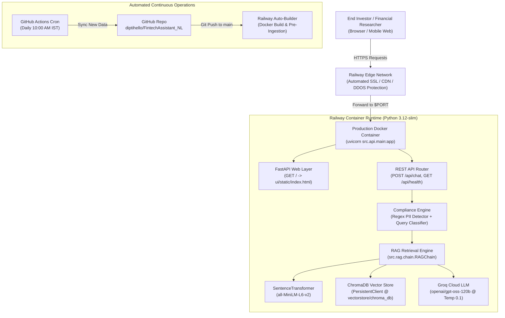
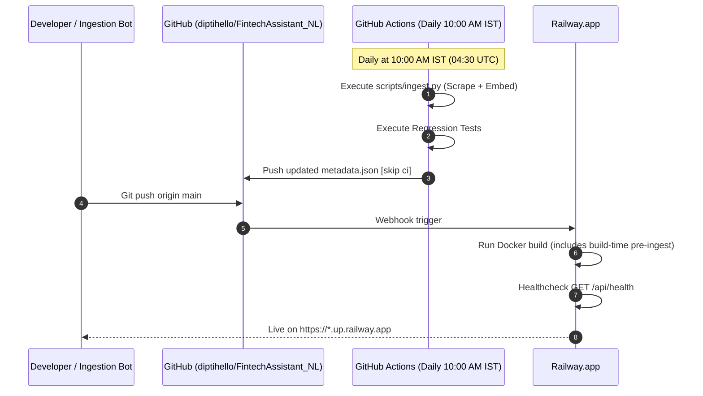

# Railway Deployment Plan: Facts-Only FinTech FAQ Assistant

[](https://railway.com/template)
[](https://railway.com)
[](https://www.python.org/)
[](https://github.com/diptihello/FintechAssistant_NL)

---

## 1. Executive Summary & Architecture

This deployment plan outlines the end-to-end strategy for hosting the **Mutual Fund & Stock FAQ Assistant (Groww Facts Q&A)** on **[Railway.app](https://railway.com)**.

The production service operates as a unified web container exposing:
1. **Facts-First Financial Intelligence UI (Stitch Dashboard)** served directly at `/` from [`ui/static/index.html`](file:///d:/Dipti/NextLeap_RAG_Project_Assignment2/ui/static/index.html).
2. **RESTful Compliance API** served at `/api/*` (Chat, Threads, Health).
3. **Swagger / OpenAPI Documentation** served at `/docs`.



---

## 2. Infrastructure Specification

| Component | Railway Specification | Notes |
|---|---|---|
| **Service Type** | Web Service (Docker container) | Built via [`Dockerfile`](file:///d:/Dipti/NextLeap_RAG_Project_Assignment2/Dockerfile) |
| **Compute Plan** | Starter / Developer Plan (vCPU: 1–2, RAM: 512MB–2GB) | PyTorch miniLM requires ~350MB RAM at steady-state |
| **Port Binding** | Dynamic `${PORT:-8000}` | Railway assigns `$PORT` automatically; bound via `src/config.py` |
| **Health Check** | `GET /api/health` | HTTP 200 response with vector count & status |
| **Restart Policy** | `ON_FAILURE` (max 10 retries) | Ensures automatic recovery if memory spikes occur |
| **Domain** | `*.up.railway.app` or Custom Domain | Automatic Let's Encrypt TLS termination |

---

## 3. Environment Variables & Secrets Matrix

Configure the following variables in the Railway Service **Variables** dashboard:

| Variable | Required? | Example / Default Value | Purpose |
|---|:---:|---|---|
| `GROQ_API_KEY` | **Yes** | `gsk_abc123...` | Primary LLM authentication token |
| `PORT` | Auto | *Injected by Railway* | Internal port assigned to the web container |
| `LLM_MODEL` | No | `openai/gpt-oss-120b` | High-conviction factual Groq model |
| `LLM_TEMPERATURE` | No | `0.1` | Strictly enforces deterministic, facts-only output |
| `LLM_MAX_TOKENS` | No | `200` | Limits responses to concise $\le 3$ sentence constraints |
| `EMBEDDING_MODEL` | No | `sentence-transformers/all-MiniLM-L6-v2` | Dense embedding model |
| `CHROMA_PERSIST_DIR` | No | `./vectorstore/chroma_db` | Path to persistent ChromaDB SQLite storage |
| `CHROMA_COLLECTION_NAME`| No | `mutual_fund_facts` | Chroma collection name |
| `API_HOST` | No | `0.0.0.0` | Listen host interface |
| `PYTHONUNBUFFERED` | No | `1` | Forces real-time streaming logs into Railway deploy log |
| `HF_HUB_OFFLINE` | No | `1` | Prevents unnecessary network calls once model is cached |

---

## 4. Configuration Files Reference

### 4.1 `railway.json`
Located at the root of the repository:
```json
{
  "$schema": "https://railway.app/railway.schema.json",
  "build": {
    "builder": "DOCKERFILE",
    "dockerfilePath": "Dockerfile"
  },
  "deploy": {
    "startCommand": "uvicorn src.api.main:app --host 0.0.0.0 --port ${PORT:-8000}",
    "healthcheckPath": "/api/health",
    "healthcheckTimeout": 120,
    "restartPolicyType": "ON_FAILURE",
    "restartPolicyMaxRetries": 10
  }
}
```

### 4.2 `Dockerfile`
Multi-stage caching ensures fast builds and sub-second container cold starts:
```dockerfile
FROM python:3.12-slim

WORKDIR /app

ENV PYTHONDONTWRITEBYTECODE=1 \
    PYTHONUNBUFFERED=1 \
    PYTHONPATH=/app \
    PORT=8000

RUN apt-get update && apt-get install -y --no-install-recommends \
    curl \
    build-essential \
    && rm -rf /var/lib/apt/lists/*

COPY requirements.txt .
RUN pip install --no-cache-dir --upgrade pip && \
    pip install --no-cache-dir -r requirements.txt

COPY . .

# Build-time ingestion: populates vectorstore and caches SentenceTransformer
RUN python scripts/ingest.py

EXPOSE 8000

HEALTHCHECK --interval=30s --timeout=5s --start-period=20s --retries=3 \
    CMD curl -f http://localhost:${PORT}/api/health || exit 1

CMD ["sh", "-c", "uvicorn src.api.main:app --host 0.0.0.0 --port ${PORT:-8000}"]
```

### 4.3 `Procfile` (Alternative Nixpacks Deployment)
```text
web: uvicorn src.api.main:app --host 0.0.0.0 --port ${PORT:-8000}
```

---

## 5. Step-by-Step Deployment Instructions

### Method A: Deploy via Railway Web Dashboard (Recommended)

1. **Sign In & Create Project:**
   - Navigate to [railway.com](https://railway.com) and log in using your GitHub account.
   - Click **+ New Project** → **Deploy from GitHub repo**.

2. **Select Repository:**
   - Choose `diptihello/FintechAssistant_NL`.
   - Select branch `main`.

3. **Configure Environment Variables:**
   - In the newly created service card, click the **Variables** tab.
   - Click **+ New Variable** and add:
     - `GROQ_API_KEY`: `<Your Groq API Key>`
     - `LLM_MODEL`: `openai/gpt-oss-120b`
     - `PYTHONUNBUFFERED`: `1`

4. **Verify Healthcheck & Deploy Settings:**
   - Under **Settings** → **Deploy**:
     - Confirm **Healthcheck Path** is `/api/health`.
     - Confirm **Healthcheck Timeout** is set to `120` seconds.

5. **Generate Public Domain:**
   - Under **Settings** → **Networking** → **Public Networking**:
     - Click **Generate Domain** (e.g., `fintechassistant-production.up.railway.app`).

6. **Trigger Deployment:**
   - Railway will trigger the initial build using the repository `Dockerfile`.
   - Monitor the **Build Logs** and **Deploy Logs**. Once complete, open the generated URL in your browser.

---

### Method B: Deploy via Railway CLI

For developers preferring the command line:

```bash
# 1. Install Railway CLI
npm i -g @railway/cli
# Or on Windows via Scoop / Brew / Cargo:
# scoop install railway

# 2. Authenticate
railway login

# 3. Link or create project
railway link
# Or to create fresh:
railway init -n "FintechAssistant-NL"

# 4. Set required secret variable
railway variables set GROQ_API_KEY="gsk_your_groq_api_key_here"

# 5. Deploy current directory
railway up --detach

# 6. Generate domain and open in browser
railway domain
railway open
```

---

## 6. ChromaDB Persistence Strategy

Railway containers operate with an ephemeral filesystem by default. This application provides two zero-data-loss strategies:

### Strategy 1: Build-Time Ingestion (Default in `Dockerfile`)
- During the `docker build` stage, `RUN python scripts/ingest.py` runs automatically.
- The 57 factual chunks, pre-computed vector embeddings, and `vectorstore/chroma_db/` SQLite files are packaged directly into the immutable Docker image.
- **Advantage:** Instant zero-downtime boots, zero latency on startup, no extra volume cost.

### Strategy 2: Railway Persistent Volume (Optional for Live In-Place Updates)
If you wish to allow daily scrapers to write directly to a persistent volume on Railway:
1. In Railway project dashboard, click **+ New** → **Volume**.
2. Mount the volume to the container at `/app/vectorstore`.
3. In Service Variables, set:
   ```env
   CHROMA_PERSIST_DIR=/app/vectorstore/chroma_db
   ```
4. Now, any daily ingestion runs on Railway will persist modifications across container redeploys.

---

## 7. CI/CD & Automated Daily Ingestion Synchronization

The project is architected with a synchronized dual-pipeline:



> **Note:** Automated commits by GitHub Actions include `[skip ci]` to prevent unnecessary rebuild cycles unless code changes are committed.

---

## 8. Post-Deployment Verification Checklist

Once the deployment status indicates **Active**, perform the following validation tests:

- [ ] **HTTP Health Check:**
  ```bash
  curl -s https://<your-railway-domain>.up.railway.app/api/health
  ```
  Expected Response:
  ```json
  {"status":"ok","version":"1.0.0","total_threads":0,"vectorstore_count":57}
  ```

- [ ] **Interactive Swagger Documentation:**
  Open `https://<your-railway-domain>.up.railway.app/docs` and execute a test query via `POST /api/chat`.

- [ ] **Stitch Frontend Verification:**
  Open `https://<your-railway-domain>.up.railway.app/` in a desktop and mobile browser:
  - Verify compliance notice at the top.
  - Submit: *"What is the expense ratio of HDFC Small Cap Fund Direct Growth?"*
  - Verify grounded response with `0.79%`, Groww citation URL, and date footer.
  - Submit: *"Should I invest in HDFC Mid Cap Fund?"* → Verify SEBI advisory refusal.
  - Submit: *"My PAN is ABCDE1234F"* → Verify PII rejection.

---

## 9. Troubleshooting Runbook

| Symptom | Probable Cause | Action / Resolution |
|---|---|---|
| **Deploy fails with `Healthcheck failed: timeout after 120s`** | Container taking longer to download SentenceTransformer or compile dependencies | In Railway Settings, increase **Healthcheck Timeout** to `180` or `240` seconds. Verify `Dockerfile` includes `RUN python scripts/ingest.py` so downloads happen during build time. |
| **Error `401 Unauthorized` on `/api/chat`** | Missing or invalid `GROQ_API_KEY` | Check Railway **Variables** tab and ensure `GROQ_API_KEY` starts with `gsk_` without extraneous quotes or whitespace. |
| **Error `Application Error: Port binding failed`** | Uvicorn hardcoded to a port other than `$PORT` | Verify `src/config.py` uses `int(os.getenv("PORT", os.getenv("API_PORT", "8000")))`. In `Dockerfile`, ensure `PORT` is passed dynamically: `--port ${PORT:-8000}`. |
| **Out of Memory (OOMKilled - Exit code 137)** | Starter plan memory limit (512MB) exceeded during PyTorch model loading | In Railway service settings, adjust memory limit to `1GB` or `2GB`. The application runs comfortably at ~400MB once steady state is reached. |
| **Responses missing source citations** | ChromaDB collection empty | Verify `/api/health` reports `vectorstore_count: 57`. If count is 0, trigger manual ingestion or check that `data/processed/chunks.json` was copied in Dockerfile. |

---

> **Plan maintained by:** FinTech AI Platform Engineering Team  
> **Source Repository:** [diptihello/FintechAssistant_NL](https://github.com/diptihello/FintechAssistant_NL)  
> **Version:** 1.0.0

