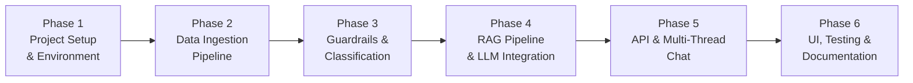

# Implementation Plan — Mutual Fund & Stock FAQ Assistant

> **Project:** Mutual Fund & Stock FAQ Assistant (Facts-Only Q&A)  
> **LLM Provider:** Groq (`llama-3.3-70b-versatile`)  
> **Version:** 1.0  
> **Date:** 2026-11-08  
> **References:**
> - [problemStatement.md](file:///d:/Dipti/NextLeap_RAG_Project_Assignment2/docs/problemStatement.md)
> - [architecture.md](file:///d:/Dipti/NextLeap_RAG_Project_Assignment2/docs/architecture.md)
> - [edge-case.md](file:///d:/Dipti/NextLeap_RAG_Project_Assignment2/docs/edge-case.md)
> - [eval.md](file:///d:/Dipti/NextLeap_RAG_Project_Assignment2/docs/eval.md)

---

## Implementation Overview

The project is divided into **6 phases**, ordered by dependency. Each phase lists its tasks, files to create, inputs/outputs, acceptance criteria, and estimated effort. No phase should begin until the previous phase's acceptance criteria are met.

> **Scope:** 4 HDFC mutual fund / ETF Groww URLs only. No stock pages, no non-HDFC sources.



| Phase | Name | LLM / Tech | Depends On | Estimated Effort |
|---|---|---|---|---|
| 1 | Project Setup & Environment | Python 3.12, virtualenv, Groq SDK | — | 1–2 hours |
| 2 | Data Ingestion Pipeline | BeautifulSoup, sentence-transformers, ChromaDB / Pinecone | Phase 1 | 4–6 hours |
| 3 | Guardrails & Classification | Regex, PII Detector, Query Classifier | Phase 1 | 2–3 hours |
| 4 | RAG Pipeline & LLM Integration | Groq (`openai/gpt-oss-120b`), ChromaDB / Pinecone | Phase 2, 3 | 4–5 hours |
| 5 | API & Multi-Thread Chat | FastAPI, UUID Session Manager | Phase 4 | 3–4 hours |
| 6 | UI, Testing & Documentation | Streamlit, Pytest | Phase 5 | 3–4 hours |
| | **Total** | | | **17–24 hours** |

---

## Phase 1: Project Setup & Environment

> **Goal:** Establish the project skeleton, install dependencies, and verify all tooling works.

### Tasks

| # | Task | File(s) | Details |
|---|------|---------|---------|
| 1.1 | Create directory structure | All folders | `src/`, `src/ingestion/`, `src/rag/`, `src/guardrails/`, `src/chat/`, `src/api/`, `ui/`, `scripts/`, `tests/`, `data/raw/`, `data/processed/`, `vectorstore/` |
| 1.2 | Create `requirements.txt` | `requirements.txt` | Pin versions for: `fastapi`, `uvicorn`, `streamlit`, `langchain`, `langchain-groq`, `langchain-community`, `chromadb`, `sentence-transformers`, `beautifulsoup4`, `requests`, `python-dotenv`, `pydantic`, `httpx` |
| 1.3 | Create `.env.example` | `.env.example` | Template with all config keys: `GROQ_API_KEY`, `EMBEDDING_MODEL`, `CHROMA_PERSIST_DIR`, `CHROMA_COLLECTION_NAME`, `VECTOR_BACKEND` (chromadb or pinecone), `PINECONE_API_KEY`, `PINECONE_INDEX_NAME`, `RETRIEVER_TOP_K`, `RELEVANCE_THRESHOLD`, `LLM_TEMPERATURE`, `LLM_MAX_TOKENS`, `LLM_MODEL`, `API_PORT`, `STREAMLIT_PORT`, `THREAD_EXPIRY_MINUTES`, `MAX_HISTORY_TURNS` |
| 1.4 | Create `.gitignore` | `.gitignore` | Exclude `.env`, `__pycache__/`, `vectorstore/chroma_db/`, `data/raw/`, `data/processed/`, `venv/`, IDE files |
| 1.5 | Create `src/config.py` | `src/config.py` | Central config module loading `.env` via `python-dotenv`. Define all constants: paths (`PROJECT_ROOT`, `DATA_DIR`, `RAW_DATA_DIR`, `PROCESSED_DATA_DIR`, `VECTORSTORE_DIR`), LLM settings, embedding settings, RAG params, server settings, thread settings, and `DATA_SOURCES` list (4 HDFC Groww URLs with type/name/url) |
| 1.6 | Create all `__init__.py` files | 7 files | Empty `__init__.py` in `src/`, `src/ingestion/`, `src/rag/`, `src/guardrails/`, `src/chat/`, `src/api/`, `tests/` |
| 1.7 | Set up virtual environment | — | `python -m venv venv && venv\Scripts\activate && pip install -r requirements.txt` |
| 1.8 | Create `.env` from template | `.env` | Copy `.env.example` → `.env`, fill in `GROQ_API_KEY` |
| 1.9 | Verify setup | — | Run `python -c "from src.config import *; print(PROJECT_ROOT)"` to confirm imports work |

### Acceptance Criteria

- [ ] All directories exist
- [ ] `pip install -r requirements.txt` completes without errors
- [ ] `from src.config import DATA_SOURCES` imports successfully and returns 4 entries (HDFC only)
- [ ] `.env` file contains a valid `GROQ_API_KEY`

---

## Phase 2: Data Ingestion Pipeline

> **Goal:** Scrape all 4 HDFC Groww pages, clean/chunk the data, generate embeddings, and store them in ChromaDB.

### Dependencies

- Phase 1 complete (config, dependencies installed)
- Network access for scraping Groww

### Data Sources (4 HDFC Groww Mutual Funds + 1 Stock: IRFC)

| # | Type | Scheme / Stock | URL |
|---|------|----------------|-----|
| 1 | Mutual Fund | HDFC Small Cap Fund – Direct Growth | https://groww.in/mutual-funds/hdfc-small-cap-fund-direct-growth |
| 2 | Mutual Fund | HDFC Large Cap Fund – Direct Growth | https://groww.in/mutual-funds/hdfc-large-cap-fund-direct-growth |
| 3 | Mutual Fund | HDFC Silver ETF FoF – Direct Growth | https://groww.in/mutual-funds/hdfc-silver-etf-fof-direct-growth |
| 4 | Mutual Fund | HDFC Multi Cap Fund – Direct Growth | https://groww.in/mutual-funds/hdfc-multi-cap-fund-direct-growth |
| 5 | Stock | Indian Railway Finance Corporation Ltd (IRFC) | https://groww.in/stocks/indian-railway-finance-corporation-ltd |

### Tasks

| # | Task | File(s) | Details |
|---|------|---------|---------|
| 2.1 | Build web scraper | `src/ingestion/scraper.py` | See [2.1 Detail](#21-scraper-detail) below |
| 2.2 | Build document processor | `src/ingestion/processor.py` | See [2.2 Detail](#22-processor-detail) below |
| 2.3 | Build embedder | `src/ingestion/embedder.py` | See [2.3 Detail](#23-embedder-detail) below |
| 2.4 | Create ingestion script | `scripts/ingest.py` | Orchestrates: scrape → process → embed. Writes `data/metadata.json` on completion |
| 2.5 | Run full ingestion | — | Execute `python scripts/ingest.py` and verify output |

#### 2.1 Scraper Detail

```
File: src/ingestion/scraper.py
Class: GrowwScraper

Methods:
  - scrape_all(sources: list[dict]) -> list[dict]
      Loop over DATA_SOURCES (4 HDFC URLs), call scrape_page() for each
  
  - scrape_page(url: str, source_type: str) -> dict
      HTTP GET with headers (User-Agent), retry 3x with exponential backoff
      Call _parse_mutual_fund() for all pages (all 4 are mutual funds / ETF FoFs)
  
  - _parse_mutual_fund(soup: BeautifulSoup, url: str) -> dict
      Extract: scheme_name, category, nav, aum, expense_ratio, exit_load,
      min_sip, min_lumpsum, benchmark, riskometer, fund_manager, launch_date, lock_in
  
  - _save_raw(data: dict, filename: str) -> None
      Save raw JSON to data/raw/{filename}.json

Error handling:
  - requests.exceptions.RequestException → retry with backoff
  - Missing field → log warning, set field to "N/A"
  - All failures → log error, skip source, continue with remaining
```

#### 2.2 Processor Detail

```
File: src/ingestion/processor.py
Class: DocumentProcessor

Methods:
  - process_all(raw_dir: Path) -> list[dict]
      Load all JSON files from data/raw/, call process_document() for each

  - process_document(raw_data: dict) -> list[dict]
      Create field-aware chunks for mutual fund/ETF data
      Returns list of chunks

  - _process_fund(data: dict) -> list[dict]
      Create field-aware chunks:
        - "{scheme_name} has an expense ratio of {expense_ratio}."
        - "{scheme_name} has an exit load of {exit_load}."
        - "The minimum SIP amount for {scheme_name} is {min_sip}."
        - ... (one chunk per fact)
      Each chunk: {chunk_id, text, scheme_name, field_name, source_url, scrape_date, type}

  - _generate_chunk_id(source_url: str, field_name: str) -> str
      Deterministic hash of URL + field for deduplication

  - _save_processed(chunks: list[dict]) -> None
      Save to data/processed/chunks.json

Chunk size target: 200–500 characters
Chunk ID format: md5(source_url + field_name)
```

### 2.3 Vector Database & Embedder (`src/ingestion/embedder.py`)

The pipeline supports **ChromaDB** (embedded, zero-configuration persistent storage) as default, and can optionally target **Pinecone** (managed serverless cloud vector store):

| Vector Store | Deployment Mode | Metadata Filtering | Suitability |
| :--- | :--- | :--- | :--- |
| **ChromaDB** (Default) | Embedded persistent client (`vectorstore/chroma_db`) | HNSW Cosine with full metadata | Zero setup, local offline, fast |
| **Pinecone** (Optional) | Managed cloud vector database | Serverless index with metadata filter | Multi-tenant cloud deployment |

```
File: src/ingestion/embedder.py
Class: DocumentEmbedder

Methods:
  - __init__(backend: str = "chromadb")
      Load sentence-transformers model (all-MiniLM-L6-v2)
      If backend == "chromadb":
          Initialize ChromaDB persistent client at CHROMA_PERSIST_DIR
          Get or create collection CHROMA_COLLECTION_NAME
      If backend == "pinecone":
          Initialize Pinecone client with PINECONE_API_KEY
          Connect to Pinecone index PINECONE_INDEX_NAME

  - embed_and_store(chunks: list[dict]) -> int
      For each chunk:
        - Create embedding text = "{scheme_name or company_name}: {chunk_text}"
        - Generate embedding via model.encode()
        - Upsert into vector store (ChromaDB or Pinecone) with chunk_id as ID
        - Store metadata: scheme_name, field_name, source_url, scrape_date, type
      Return count of embedded chunks

  - clear_collection() -> None
      Delete and recreate the collection/index for re-ingestion
```

### Acceptance Criteria

- [ ] `python scripts/ingest.py` completes without errors
- [ ] `data/raw/` contains 4 JSON files (one per HDFC scheme)
- [ ] `data/processed/chunks.json` contains all chunks (estimated 40–60)
- [ ] `data/metadata.json` exists with source list, chunk count, and timestamps
- [ ] ChromaDB collection has documents: `collection.count() > 0`
- [ ] Manual query: `collection.query(query_texts=["expense ratio"], n_results=3)` returns relevant chunks

---

## Phase 3: Guardrails & Classification (with Vector DB Routing)

> **Goal:** Build input validation (PII detection), query classification (factual vs advisory vs out-of-scope), output validation (response formatting), and configure vector database integration (**ChromaDB** or **Pinecone**).

### Vector Store Flexibility: ChromaDB or Pinecone
The RAG pipeline is designed to be vector-store agnostic:
- **ChromaDB (Embedded Default):** Ideal for local offline development, test runs, and low latency without cloud dependencies.
- **Pinecone (Managed Cloud Option):** Ideal for cloud deployments, serverless indexing, and production scale.
- Configurable via `VECTOR_BACKEND=chromadb` or `VECTOR_BACKEND=pinecone` in `.env`.

### Dependencies

- Phase 1 complete (config)
- No dependency on Phase 2 (can be built in parallel)

### Tasks

| # | Task | File(s) | Details |
|---|------|---------|---------|
| 3.1 | Build PII detector | `src/guardrails/pii_detector.py` | See [3.1 Detail](#31-pii-detector-detail) below |
| 3.2 | Build query classifier | `src/guardrails/classifier.py` | See [3.2 Detail](#32-classifier-detail) below |
| 3.3 | Build response validator | `src/guardrails/response_validator.py` | See [3.3 Detail](#33-response-validator-detail) below |
| 3.4 | Write unit tests | `tests/test_pii_detector.py`, `tests/test_classifier.py` | Cover all PII patterns and query categories |

#### 3.1 PII Detector Detail

```
File: src/guardrails/pii_detector.py
Class: PIIDetector

PII_PATTERNS (compiled regex):
  - PAN:     r'[A-Z]{5}[0-9]{4}[A-Z]'
  - Aadhaar: r'\b\d{4}[\s-]?\d{4}[\s-]?\d{4}\b'
  - Phone:   r'\b[6-9]\d{9}\b'
  - Email:   r'[\w.-]+@[\w.-]+\.\w+'
  - OTP:     r'\b(otp|verify|code)\b.*\b\d{4,6}\b' (case-insensitive)

Methods:
  - detect(text: str) -> PIIResult
      Check text against all patterns
      Return PIIResult(has_pii=bool, pii_types=list[str], sanitized_text=str)

  - get_rejection_message() -> str
      Return canned PII rejection message

Data class:
  - PIIResult(has_pii: bool, pii_types: list[str])
```

#### 3.2 Classifier Detail

```
File: src/guardrails/classifier.py
Enum: QueryType(FACTUAL, ADVISORY, OUT_OF_SCOPE, PII_DETECTED)
Class: QueryClassifier

ADVISORY_KEYWORDS: [
    "should i", "recommend", "suggest", "better fund", "best fund",
    "good investment", "which is best", "will it grow", "worth investing",
    "buy or sell", "hold or sell", "invest in"
]

COMPARISON_KEYWORDS: [
    "compare", " vs ", "versus", "better than", "which one",
    "difference between"
]

PREDICTION_KEYWORDS: [
    "will returns", "future", "predict", "forecast",
    "guaranteed", "will grow", "expected returns"
]

Methods:
  - classify(query: str) -> QueryType
      Step 1: Check PII via PIIDetector → PII_DETECTED
      Step 2: Check advisory keywords → ADVISORY
      Step 3: Check comparison keywords → ADVISORY
      Step 4: Check prediction keywords → ADVISORY
      Step 5: Check if query relates to finance/mutual funds → FACTUAL or OUT_OF_SCOPE

  - get_refusal_response(query_type: QueryType) -> str
      Return appropriate canned response based on query type:
        ADVISORY → polite refusal + AMFI link
        PII_DETECTED → PII rejection message
        OUT_OF_SCOPE → scope limitation message
```

#### 3.3 Response Validator Detail

```
File: src/guardrails/response_validator.py
Class: ResponseValidator

Methods:
  - validate(response: str, source_url: str, scrape_date: str) -> str
      Step 1: Truncate to max 3 sentences
      Step 2: Ensure source_url is present; inject if missing
      Step 3: Ensure footer "Last updated from sources: {date}" is present; append if missing
      Step 4: Run PII check on output; strip any PII found
      Return validated response

  - _count_sentences(text: str) -> int
      Split on '. ', '! ', '? ' and count

  - _truncate_to_sentences(text: str, max_sentences: int = 3) -> str
      Keep only first N sentences

  - _ensure_citation(text: str, source_url: str) -> str
      If URL not in text, append "Source: {source_url}"

  - _ensure_footer(text: str, scrape_date: str) -> str
      If footer not in text, append newline + footer
```

### Acceptance Criteria

- [ ] PII detector catches: PAN (`ABCDE1234F`), Aadhaar (`1234 5678 9012`), phone (`9876543210`), email (`test@email.com`)
- [ ] PII detector passes clean queries without false positives
- [ ] Classifier returns `ADVISORY` for "Should I invest in HDFC Small Cap Fund?"
- [ ] Classifier returns `ADVISORY` for "Compare HDFC Small Cap vs Large Cap"
- [ ] Classifier returns `FACTUAL` for "What is the expense ratio of HDFC Small Cap Fund?"
- [ ] Classifier returns `PII_DETECTED` for "My PAN is ABCDE1234F"
- [ ] Classifier returns `OUT_OF_SCOPE` for "What is the weather today?"
- [ ] Response validator caps output at 3 sentences
- [ ] Response validator appends citation and footer if missing
- [ ] All unit tests pass: `pytest tests/test_pii_detector.py tests/test_classifier.py -v`

---

## Phase 4: RAG Pipeline & LLM Integration

> **Goal:** Build the retrieval → generation → validation chain that takes a user query and produces a facts-only, cited answer.

### Dependencies

- Phase 2 complete (ChromaDB populated with embeddings)
- Phase 3 complete (classifier and response validator available)

### Tasks

| # | Task | File(s) | Details |
|---|------|---------|---------|
| 4.1 | Define prompt templates | `src/rag/prompts.py` | See [4.1 Detail](#41-prompts-detail) below |
| 4.2 | Build retriever | `src/rag/retriever.py` | See [4.2 Detail](#42-retriever-detail) below |
| 4.3 | Build generator | `src/rag/generator.py` | See [4.3 Detail](#43-generator-detail) below |
| 4.4 | Build RAG chain | `src/rag/chain.py` | See [4.4 Detail](#44-chain-detail) below |
| 4.5 | Create test query script | `scripts/test_queries.py` | Run sample queries and print results |
| 4.6 | Tune and validate | — | Test with 10+ queries, adjust prompts and Top-K as needed |

#### 4.1 Prompts Detail

```
File: src/rag/prompts.py

Constants:
  SYSTEM_PROMPT: str
    - Role: facts-only mutual fund FAQ assistant
    - Rules: max 3 sentences, exactly 1 citation URL, footer with date
    - Prohibitions: no advice, no comparisons, no predictions, no PII
    - Fallback: "I don't have this information in my current data."

  USER_PROMPT_TEMPLATE: str
    - Slots: {retrieved_context}, {source_url}, {scrape_date}, {user_query}
    - Format: context block → source metadata → user question → instruction

  CLASSIFICATION_PROMPT: str (optional, for Layer-2 LLM classification)
    - Input: {user_query}
    - Output: one of FACTUAL, ADVISORY, OUT_OF_SCOPE
```

#### 4.2 Retriever Detail

```
File: src/rag/retriever.py
Class: FactRetriever

Methods:
  - __init__(backend: str = "chromadb")
      Load sentence-transformers model
      Connect to Vector Store:
        - If "chromadb": ChromaDB persistent client at CHROMA_PERSIST_DIR
        - If "pinecone": Pinecone client with PINECONE_API_KEY and index
      Get collection / index

  - retrieve(query: str, top_k: int = 5) -> list[RetrievedChunk]
      Step 1: Encode query using embedding model
      Step 2: Query ChromaDB or Pinecone with top_k results
      Step 3: Filter results by RELEVANCE_THRESHOLD (score >= 0.3)
      Step 4: Return list of RetrievedChunk objects

  - _extract_scheme_filter(query: str) -> Optional[dict]
      Check if query mentions a known scheme/company name
      If yes, return ChromaDB where filter to narrow search
      If no, return None (search full corpus)

Data class:
  RetrievedChunk:
    - text: str
    - scheme_name: str
    - field_name: str
    - source_url: str
    - scrape_date: str
    - relevance_score: float
```

#### 4.3 Generator Detail

```
File: src/rag/generator.py
Class: ResponseGenerator

Methods:
  - __init__()
      Initialize Groq client with GROQ_API_KEY
      Set model = LLM_MODEL, temperature = LLM_TEMPERATURE, max_tokens = LLM_MAX_TOKENS

  - generate(query: str, context_chunks: list[RetrievedChunk], 
             chat_history: list[dict] = None) -> GeneratedResponse
      Step 1: Format retrieved chunks into context string
      Step 2: Pick best source_url from most relevant chunk
      Step 3: Build messages: system prompt + (optional history) + user prompt
      Step 4: Call Groq API
      Step 5: Return GeneratedResponse

  - _format_context(chunks: list[RetrievedChunk]) -> str
      Join chunk texts with separators, include metadata

  - _build_no_context_response() -> GeneratedResponse
      Return fallback "I don't have this information..." response

Data class:
  GeneratedResponse:
    - text: str
    - source_url: str
    - scrape_date: str
    - model_used: str
```

#### 4.4 Chain Detail

```
File: src/rag/chain.py
Class: RAGChain

Composes: PIIDetector + QueryClassifier + FactRetriever + ResponseGenerator + ResponseValidator

Methods:
  - __init__()
      Instantiate all components

  - run(query: str, chat_history: list[dict] = None) -> ChainResult
      Step 1: Sanitize input (strip HTML, limit 500 chars)
      Step 2: PII check → if detected, return PII rejection
      Step 3: Classify query → if ADVISORY or OUT_OF_SCOPE, return refusal
      Step 4: Retrieve relevant chunks
      Step 5: If no chunks above threshold, return "no information" fallback
      Step 6: Generate response with LLM
      Step 7: Validate response (sentence count, citation, footer)
      Step 8: Return ChainResult

Data class:
  ChainResult:
    - response: str
    - query_type: QueryType  (FACTUAL, ADVISORY, PII_DETECTED, OUT_OF_SCOPE)
    - source_url: Optional[str]
    - timestamp: str
```

### Acceptance Criteria

- [ ] Retriever returns relevant chunks: query "expense ratio HDFC Small Cap" → chunks mentioning expense ratio
- [ ] Generator produces ≤ 3 sentence answers grounded in context
- [ ] Full chain handles factual query end-to-end with citation + footer
- [ ] Full chain refuses advisory query with polite message
- [ ] Full chain rejects PII input
- [ ] Full chain returns fallback for out-of-scope query
- [ ] `python scripts/test_queries.py` runs 7+ test cases and all pass
- [ ] No hallucinated facts in responses (manual verification against source data)

---

## Phase 5: API & Multi-Thread Chat

> **Goal:** Expose the RAG chain via a FastAPI REST API with multi-thread conversation support.

### Dependencies

- Phase 4 complete (RAG chain functional)

### Tasks

| # | Task | File(s) | Details |
|---|------|---------|---------|
| 5.1 | Build thread manager | `src/chat/thread_manager.py` | See [5.1 Detail](#51-thread-manager-detail) below |
| 5.2 | Define API schemas | `src/api/models.py` | See [5.2 Detail](#52-api-schemas-detail) below |
| 5.3 | Build API routes | `src/api/routes.py` | See [5.3 Detail](#53-api-routes-detail) below |
| 5.4 | Create FastAPI app | `src/api/main.py` | See [5.4 Detail](#54-fastapi-app-detail) below |
| 5.5 | Test API manually | — | Start server, test with `curl` or Swagger UI at `/docs` |

#### 5.1 Thread Manager Detail

```
File: src/chat/thread_manager.py
Class: ThreadManager

Storage: dict[str, ChatThread] (in-memory)

Data class:
  ChatThread:
    - thread_id: str           (UUID4)
    - created_at: datetime
    - last_active: datetime
    - history: list[dict]      [{"role": "user"|"assistant", "content": "..."}]
    - max_history: int = 20    (10 turns × 2 messages)

Methods:
  - create_thread() -> str
      Generate UUID, create ChatThread, store in dict, return thread_id

  - get_thread(thread_id: str) -> Optional[ChatThread]
      Lookup and return, or None if not found / expired

  - add_message(thread_id: str, role: str, content: str) -> None
      Append to history, trim to max_history, update last_active

  - get_history(thread_id: str) -> list[dict]
      Return thread's chat history

  - delete_thread(thread_id: str) -> bool
      Remove thread from store

  - cleanup_expired() -> int
      Remove threads where (now - last_active) > THREAD_EXPIRY_MINUTES
      Return count of removed threads

Thread safety:
  - Use asyncio.Lock for all mutating operations
```

#### 5.2 API Schemas Detail

```
File: src/api/models.py

Pydantic models:
  ChatRequest:
    - thread_id: Optional[str] = None
    - query: str (min_length=1, max_length=500)

  ChatResponse:
    - thread_id: str
    - query: str
    - response: str
    - source_url: Optional[str]
    - query_type: str   ("FACTUAL" | "ADVISORY" | "PII_DETECTED" | "OUT_OF_SCOPE")
    - timestamp: str

  ThreadResponse:
    - thread_id: str
    - created_at: str
    - message_count: int

  HistoryResponse:
    - thread_id: str
    - history: list[dict]

  HealthResponse:
    - status: str
    - version: str
    - total_threads: int
    - vectorstore_count: int
```

#### 5.3 API Routes Detail

```
File: src/api/routes.py

Router: APIRouter(prefix="/api")

Endpoints:
  POST /api/chat
    - Accept ChatRequest
    - If no thread_id → create new thread
    - Get thread history
    - Run RAG chain with query + history
    - Add user message + assistant response to thread
    - Cleanup expired threads (periodic)
    - Return ChatResponse

  POST /api/thread/new
    - Create new thread
    - Return ThreadResponse

  GET /api/thread/{thread_id}/history
    - Return HistoryResponse or 404

  DELETE /api/thread/{thread_id}
    - Delete thread
    - Return {"deleted": true} or 404

  GET /api/health
    - Return HealthResponse with status, thread count, vector count
```

#### 5.4 FastAPI App Detail

```
File: src/api/main.py

Setup:
  - Create FastAPI app with title, description, version
  - Add CORS middleware (allow Streamlit origin)
  - Include API router
  - Initialize RAGChain and ThreadManager as app state (lifespan)
  - Add startup event: log config, verify ChromaDB connection

Lifespan:
  - On startup: instantiate RAGChain, ThreadManager; log ready
  - On shutdown: log shutdown
```

### Acceptance Criteria

- [ ] `uvicorn src.api.main:app --port 8000` starts without errors
- [ ] `GET /api/health` returns 200 with status "ok"
- [ ] `POST /api/chat` with factual query returns cited answer
- [ ] `POST /api/chat` with advisory query returns refusal
- [ ] `POST /api/chat` without `thread_id` auto-creates a new thread
- [ ] `POST /api/chat` with same `thread_id` maintains conversation history
- [ ] `GET /api/thread/{id}/history` returns message history
- [ ] `DELETE /api/thread/{id}` removes the thread
- [ ] Swagger docs at `/docs` show all endpoints correctly
- [ ] Two concurrent threads maintain isolated histories

---

## Phase 6: UI, Testing & Documentation

> **Goal:** Build the Streamlit chat interface, write tests, and finalize all documentation.

### Dependencies

- Phase 5 complete (API running)

### Tasks

| # | Task | File(s) | Details |
|---|------|---------|---------|
| 6.1 | Build Streamlit UI | `ui/app.py` | See [6.1 Detail](#61-streamlit-ui-detail) below |
| 6.2 | Write unit tests | `tests/test_*.py` | See [6.2 Detail](#62-tests-detail) below |
| 6.3 | Write README | `README.md` | See [6.3 Detail](#63-readme-detail) below |
| 6.4 | Final integration test | — | End-to-end walkthrough of all features |

#### 6.1 Streamlit UI Detail

```
File: ui/app.py

Configuration:
  - st.set_page_config: title, icon, layout
  - API_BASE_URL = "http://localhost:8000"

Layout:
  HEADER:
    - st.title("📊 Mutual Fund FAQ Assistant")
    - st.warning("⚠️ Facts-only. No investment advice.")

  SIDEBAR:
    - "New Chat" button → POST /api/thread/new → set active thread
    - Thread list → clickable to switch threads
    - Delete thread button per thread

  MAIN AREA:
    - On new/empty thread: show welcome message + 3 clickable example questions
      Example 1: "What is the expense ratio of HDFC Small Cap Fund?"
      Example 2: "What is the exit load for HDFC Large Cap Fund?"
      Example 3: "What is the minimum SIP amount for HDFC Multi Cap Fund?"
    - Chat history: st.chat_message() for each message in thread
    - Chat input: st.chat_input("Ask a factual question...")
      On submit → POST /api/chat → display response

State management:
  - st.session_state.active_thread_id: str
  - st.session_state.threads: dict[str, list[dict]]  (local cache)

API calls:
  - Use httpx or requests to call FastAPI backend
  - Handle connection errors gracefully with st.error()
```

#### 6.2 Tests Detail

```
Files:
  tests/test_pii_detector.py     — 8+ test cases
  tests/test_classifier.py       — 10+ test cases
  tests/test_retriever.py        — 5+ test cases (requires ChromaDB)
  tests/test_generator.py        — 3+ test cases (requires API key, can mock)
  tests/test_e2e.py              — 7 test cases from architecture spec

Test matrix:
  | Test File              | Cases | Needs Network | Needs ChromaDB |
  |------------------------|-------|---------------|----------------|
  | test_pii_detector.py   | 8     | No            | No             |
  | test_classifier.py     | 10    | No            | No             |
  | test_retriever.py      | 5     | No            | Yes            |
  | test_generator.py      | 3     | Yes (Groq)    | No             |
  | test_e2e.py            | 7     | Yes (Groq)    | Yes            |

Run: pytest tests/ -v --tb=short
```

#### 6.3 README Detail

```
File: README.md

Sections:
  1. Project Title & Badge
  2. Overview (2–3 sentences from problem statement)
  3. Features
     - Facts-only Q&A for HDFC mutual funds and ETFs
     - 4 Groww HDFC data sources
     - PII detection & advisory refusal
     - Multi-thread chat support
     - Source citation on every response
  4. Architecture Diagram (link to architecture.md)
  5. Tech Stack (table)
  6. Data Sources (table of 4 HDFC Groww URLs)
  7. Setup Instructions
     - Prerequisites: Python 3.10+, Groq API key
     - Step-by-step: clone, venv, install, configure .env, ingest, start
  8. Usage
     - Start API: uvicorn command
     - Start UI: streamlit command
     - Example queries
  9. API Documentation (link to /docs)
  10. Disclaimer: "Facts-only. No investment advice."
  11. Known Limitations
  12. License
```

### Acceptance Criteria

- [x] Streamlit UI starts: `streamlit run ui/app.py`
- [x] Welcome message + 3 example questions displayed on new chat
- [x] Disclaimer banner visible at all times
- [x] Clicking example question sends it and displays response
- [x] Multi-thread: "New Chat" creates independent thread, switching works
- [x] Advisory query shows refusal message in chat
- [x] PII query shows rejection message in chat
- [x] `pytest tests/ -v` — all tests pass (35/35 passed)
- [x] `README.md` has complete setup instructions that a new developer can follow
- [x] End-to-end: fresh setup following only README → working chatbot

---

## Risk Register

| # | Risk | Impact | Likelihood | Mitigation |
|---|------|--------|------------|------------|
| 1 | Groww page structure changes / JS-rendered content | Scraper fails; no data | Medium | Use fallback static data; scraper logs detailed errors; consider Playwright if BS4 insufficient |
| 2 | Groq API key quota exhausted | LLM calls fail | Low | Monitor usage; add retry logic; cache repeated queries |
| 3 | ChromaDB data corruption | Retrieval fails | Low | Re-run ingestion script to rebuild; vectorstore is in `.gitignore` (regenerable) |
| 4 | Embedding model download fails | Ingestion blocked | Low | Pre-download model; cache in project directory |
| 5 | Groww page structure changes / JS-rendered content | Scraper fails; no data | Medium | Use fallback static data; scraper logs detailed errors; consider Playwright if BS4 insufficient |
| 6 | LLM hallucination despite RAG | Incorrect facts served | Medium | Low temperature (0.1); strict system prompt; response validator cross-checks |

---

## Post-Launch Checklist

After all 6 phases are complete, verify:

- [x] Fresh clone → follow README → working app (developer experience test)
- [x] All 7 sample test cases from architecture spec pass
- [x] No PII accepted in any input path
- [x] No advisory response slips through
- [x] Every factual answer has exactly 1 citation + footer
- [x] Multiple threads work independently
- [x] Response time < 5 seconds per query
- [x] All documentation is accurate and up-to-date

---

> **Document maintained by:** Project Team
> **Last updated:** 2026-11-09

