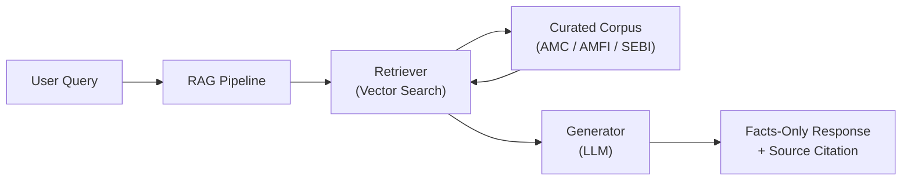

# Problem Statement: Mutual Fund FAQ Assistant (Facts-Only Q&A)

## Overview

The objective of this project is to build a **facts-only FAQ assistant** for mutual fund schemes, using **Groww** as the reference product context. The assistant answers objective, verifiable queries related to mutual funds by retrieving information exclusively from official public sources such as AMC (Asset Management Company) websites, AMFI, and SEBI.

> **The system must strictly avoid providing investment advice, opinions, or recommendations.** Every response must include a single, clear source link and adhere to defined constraints around clarity, accuracy, and compliance.

---

## Objective

Design and implement a lightweight **Retrieval-Augmented Generation (RAG)**-based assistant that:

- Answers factual queries about mutual fund schemes
- Uses a curated corpus of official documents
- Provides concise, source-backed responses

---

## Target Users

| User Segment | Use Case |
|---|---|
| Retail investors | Comparing mutual fund schemes based on factual data |
| Customer support & content teams | Handling repetitive mutual fund queries |

---

## Scope of Work

### 1. Corpus Definition

- **AMC Selected:** HDFC AMC (with selected PSU Stock: IRFC)
- **Data Sources (Groww URLs):**

  | # | Type | Scheme / Stock | URL |
  |---|------|----------------|-----|
  | 1 | Mutual Fund | HDFC Small Cap Fund – Direct Growth | https://groww.in/mutual-funds/hdfc-small-cap-fund-direct-growth |
  | 2 | Mutual Fund | HDFC Large Cap Fund – Direct Growth | https://groww.in/mutual-funds/hdfc-large-cap-fund-direct-growth |
  | 3 | Mutual Fund | HDFC Silver ETF FoF – Direct Growth | https://groww.in/mutual-funds/hdfc-silver-etf-fof-direct-growth |
  | 4 | Mutual Fund | HDFC Multi Cap Fund – Direct Growth | https://groww.in/mutual-funds/hdfc-multi-cap-fund-direct-growth |
  | 5 | Stock | Indian Railway Finance Corporation Ltd (IRFC) | https://groww.in/stocks/indian-railway-finance-corporation-ltd |

### 2. FAQ Assistant Requirements

The assistant must answer **facts-only** queries, including but not limited to:

- Expense ratio of a scheme
- Exit load details
- Minimum SIP amount
- ELSS lock-in period
- Riskometer classification
- Benchmark index
- Process to download statements or capital gains reports
- Stock metrics for IRFC (Market capitalization, P/E ratio, 52-week high/low, dividend yield, sector)

**Response Rules:**

| Rule | Requirement |
|------|-------------|
| Length | Maximum **3 sentences** per response |
| Citation | Exactly **one citation link** per response |
| Footer | `"Last updated from sources: <date>"` appended to every answer |

### 3. Refusal Handling

The assistant must **refuse** non-factual or advisory queries such as:

- *"Should I invest in this fund?"*
- *"Which fund is better?"*

**Refusal responses must:**

- Be polite and clearly worded
- Reinforce the facts-only limitation
- Provide a relevant educational link (e.g., AMFI or SEBI resource)

### 4. User Interface (Minimal)

The solution should include a simple interface with:

- A **welcome message**
- **Three example questions**
- A visible **disclaimer:** `"Facts-only. No investment advice."`

---

## Constraints

### Data & Sources

- Use **only** official public sources (AMC, AMFI, SEBI)
- Do **not** use third-party blogs or aggregator websites

### Privacy & Security

The system must **not** collect, store, or process any of the following:

- PAN or Aadhaar numbers
- Account numbers
- OTPs
- Email addresses or phone numbers

### Content Restrictions

- ❌ No investment advice or recommendations
- ❌ No performance comparisons or return calculations
- ✅ For performance-related queries, provide a link to the official factsheet only

### Transparency

- Responses must be short, factual, and verifiable
- Every answer must include a **source link** and **last updated date**

---

## Expected Deliverables

| # | Deliverable | Details |
|---|-------------|---------|
| 1 | **README Document** | Setup instructions, selected AMC & schemes, architecture overview (RAG approach), known limitations |
| 2 | **Disclaimer Snippet** | `"Facts-only. No investment advice."` |
| 3 | **Multiple Chat Thread Support** | A RAG-based chatbot capable of handling multiple independent conversations or threads simultaneously |

---

## Success Criteria

- [x] Accurate retrieval of factual mutual fund information
- [x] Strict adherence to facts-only responses
- [x] Consistent inclusion of valid source citations
- [x] Proper refusal of advisory queries
- [x] Clean, minimal, and user-friendly interface

---

## Architecture (High-Level)

---

## Summary

The goal is to build a **trustworthy, transparent, and compliant** mutual fund FAQ assistant that prioritizes **accuracy over intelligence**. The system ensures that users receive only verified, source-backed financial information — without any advisory bias or speculative content.

