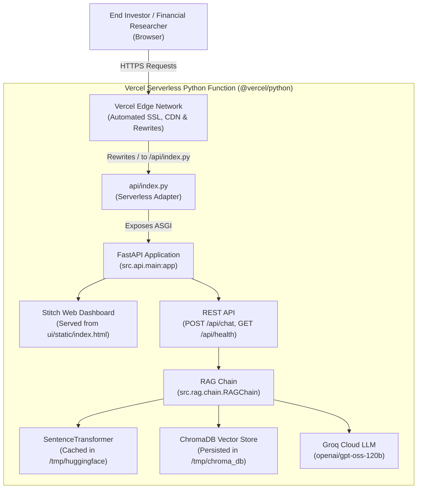

# Vercel Deployment Plan: Facts-Only FinTech FAQ Assistant

[](https://vercel.com/new)
[](https://vercel.com)
[](https://vercel.com/docs/runtimes/python)
[](https://github.com/diptihello/FintechAssistant_NL)

---

## 1. Overview & Architecture on Vercel

This document outlines the deployment configuration for hosting the **Mutual Fund & Stock FAQ Assistant** on **[Vercel](https://vercel.com)** using Vercel Serverless Functions.

Unlike traditional container platforms (such as Railway or Render), Vercel runs Python applications as on-demand, stateless **AWS Lambda-based Serverless Functions** with:
- Ephemeral root filesystem (`/var/task` is strictly read-only).
- Writable scratch storage limited to `/tmp` (512MB default).
- Zero-downtime serverless auto-scaling and global edge CDN caching.



---

## 2. Serverless Adaptations Implemented

Because Vercel serverless environments enforce a read-only root filesystem and ephemeral container lifecycles, the following adaptations were built into the codebase:

1. **Serverless Entry Point ([`api/index.py`](file:///d:/Dipti/NextLeap_RAG_Project_Assignment2/api/index.py)):**
   - Automatically detects `VERCEL=1`.
   - Re-routes all persistent directories (`HF_HOME`, `TRANSFORMERS_CACHE`, `TORCH_HOME`, and `CHROMA_PERSIST_DIR`) to `/tmp`.
   - On container cold-start, automatically runs self-ingestion (`run_ingestion()`) into `/tmp/chroma_db` if not already present.
2. **Routing & Bundling Configuration ([`vercel.json`](file:///d:/Dipti/NextLeap_RAG_Project_Assignment2/vercel.json)):**
   - Configures `@vercel/python` builder on `api/index.py`.
   - Uses `includeFiles` to bundle `src/`, `ui/`, `data/`, and `scripts/`.
   - Routes all HTTP traffic (`/(.*)`) directly to the ASGI handler.
3. **Bundle Size Optimization ([`.vercelignore`](file:///d:/Dipti/NextLeap_RAG_Project_Assignment2/.vercelignore)):**
   - Excludes `.git`, `tests/`, `docs/`, `venv/`, and design assets to keep the function bundle well below Vercel's 250MB uncompressed limit.

---

## 3. Environment Variables Configuration

Configure these variables in your Vercel Project Settings under **Environment Variables**:

| Variable | Required? | Example Value | Description |
|---|:---:|---|---|
| `GROQ_API_KEY` | **Yes** | `gsk_abc123...` | Groq Cloud API key for `openai/gpt-oss-120b` |
| `LLM_MODEL` | No | `openai/gpt-oss-120b` | Compliant Groq LLM model |
| `LLM_TEMPERATURE` | No | `0.1` | Zero/low-temperature deterministic grounding |
| `LLM_MAX_TOKENS` | No | `200` | Limits output length ($\le 3$ sentences) |
| `EMBEDDING_MODEL` | No | `sentence-transformers/all-MiniLM-L6-v2` | Dense embedding model |
| `PYTHONUNBUFFERED` | No | `1` | Stream real-time logs in Vercel Runtime Logs |

---

## 4. Step-by-Step Deployment Instructions

### Method A: Deploy via Vercel Web Dashboard (Recommended)

1. **Sign In to Vercel:**
   - Go to [vercel.com](https://vercel.com) and log in with your GitHub account.

2. **Import Repository:**
   - Click **Add New...** → **Project**.
   - Select **`diptihello/FintechAssistant_NL`**.

3. **Configure Project Settings:**
   - **Framework Preset:** Select **Other**.
   - **Root Directory:** `./` (Leave as root).
   - Expand **Environment Variables** and add:
     - Key: `GROQ_API_KEY`
     - Value: `<Your Groq API Key>`

4. **Deploy:**
   - Click **Deploy**.
   - Vercel will install dependencies from `requirements.txt`, bundle the serverless function, and provision a live URL (e.g. `https://fintech-assistant-nl.vercel.app`).

---

### Method B: Deploy via Vercel CLI

```bash
# 1. Install Vercel CLI
npm install -g vercel

# 2. Login to Vercel
vercel login

# 3. Deploy to Preview
vercel

# 4. Set Environment Variable
vercel env add GROQ_API_KEY

# 5. Deploy to Production
vercel --prod
```

---

## 5. Architectural Comparison: Vercel vs. Railway

| Dimension | Vercel (Serverless) | Railway (Docker Container) |
|---|---|---|
| **Execution Model** | Stateless Serverless Functions | Long-running container (Uvicorn) |
| **Cold Starts** | ~4–8s on cold container | 0s (Instant response, model pre-loaded) |
| **Filesystem** | Ephemeral, read-only except `/tmp` | Persistent or container storage |
| **Cost** | Free tier available | Free tier / Usage-based |
| **Best For** | Static UI + lightweight APIs | High-throughput RAG & local embeddings |

---

## 6. Post-Deployment Verification Checklist

Once deployed on Vercel:

- [ ] Visit `https://<your-project>.vercel.app/` — verify that the Stitch FinTech Web Dashboard loads cleanly.
- [ ] Visit `https://<your-project>.vercel.app/api/health` — verify response:
  ```json
  {"status":"ok","version":"1.0.0","total_threads":0,"vectorstore_count":57}
  ```
- [ ] Visit `https://<your-project>.vercel.app/docs` — verify interactive Swagger documentation.
- [ ] Submit a test query: *"What is the expense ratio of HDFC Small Cap Fund Direct Growth?"* — verify factual answer with citation link and date footer.

---

> **Plan maintained by:** FinTech AI Platform Engineering Team  
> **Source Repository:** [diptihello/FintechAssistant_NL](https://github.com/diptihello/FintechAssistant_NL)
